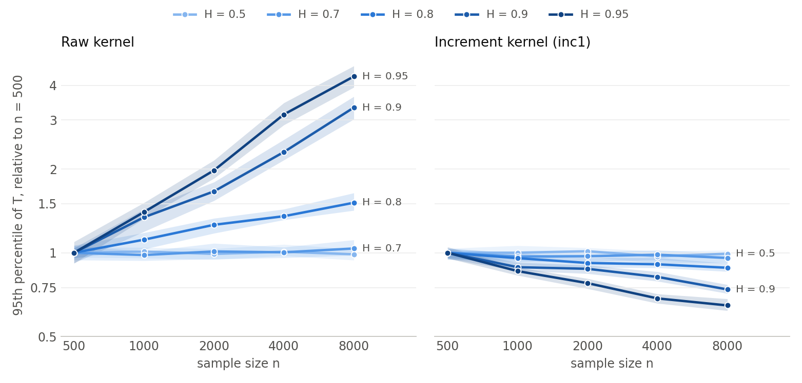

# EXP7 results: kernels built to remove long memory

Simulation only. Main master 2026110172. 142 cells and 166,400 rows, with 0 error rows. 1,000 replications per cell at n ≤ 2000, 300 at n = 4000, and 2,000 per growth cell. Every number below comes from `summary_main.csv`, `results_main.json`, `layer_bias.csv` or `layer_true_vs_est.csv`. The compact tables are in `results_tables_main.md` and the full tables in `tables_main.md`. Rates are in percent. Marks: no mark means valid, * mildly oversized, ** oversized (DESIGN.md). With 1,000 replications, a Wilson 95% interval at 5% is about ±1.4 pp. At n = 4000 it is about ±2.5 pp.

**Revision note (2026-11-03).** This file was revised after the adversarial review in `investigations/memory-kernel-2026-11-01/REVIEW.md`. Every revised passage is marked **[Revised 2026-11-03, post-review]**. The text it replaces stays visible below it, marked *Original, before review*. No rate changed, because the rows did not change. The new numbers come from `review_checks.py`, which writes `trend_main.csv`, `binomial_valid.csv`, `growth_bandwidth.csv` and `bandwidth_check.csv`.

## The answer in five points **[Revised 2026-11-03, post-review]**

1. **No memory kernel passes the pre-registered "removes memory" rule under wild or subsampling.** That rule asks for validity in all 24 Gaussian independence cells and no rise from n = 500 to n = 4000. It is the primary reading (DESIGN.md). The weaker secondary reading holds for Gaussian independence tests only. No memory kernel shows a rising H trend under wild or shift that survives a Bonferroni bound, with one exception. hp10 under wild climbs from 7.6% (H ≤ 0.6) to 8.8% (H ≥ 0.8), p = 0.0016. The pooled wild rates of the single-kernel rules, 7.2% to 8.3%, match raw wild without memory (7.2% at H ≤ 0.6). inc50 is the exception, at 18.2%. So the wild excess is the rule's own error. At n = 2000 and H = 0.95, raw wild rejects 19.1% and raw subsampling 62.4%. inc1 rejects 6.7% (wild), 5.2% (shift) and 2.7% (subsampling). **For split MMD the reading does not hold in general.** Several memory kernels climb with H on heavy-tailed HT-S data. hsplit2 comes closest to holding on both G0 and HT-S, but its plug-in rule is not memory-flat on G0 (section 1b).
2. **The raw null grows with n, and the inc1 null does not.** For raw, the 95th percentile of T grows 4.3 times from n = 500 to n = 8000 at H = 0.95. For inc1 it falls to 0.65 of its n = 500 value. The fall comes mostly from the median bandwidth, which is still far below its limit at these n. At a fixed bandwidth the inc1 ratio is 0.84 (section 2).
3. **The strict all-24-cells rule cannot rank kernels under shift.** A rule at exactly 5% passes all 24 cells with probability 0.50. Pooled over the 24 cells, every memory kernel under shift sits at 4.95% to 5.55%, with inc50 highest, and none has an H trend that survives a Bonferroni bound. These kernels all behave like 5% rules under shift. Raw shift is the exception: 5.97% pooled, rising with H (p = 1.5e-9).
4. **Each kernel has a blind spot, and they differ.** inc1, datadiff and dcov_inc1 detect only 4.3% to 10.3% under the flat moving average or the common slow factor. herm1, herm2 and sym detect only 4.4% to 7.0% under linear dependence. The memory kernels win at high H on squared and scale dependence.
5. **Harris rejects 1.6% to 3.8% in every stationary null.** Its theorem covers the literal form with segment bandwidths. That form was checked against the main columns only at N = 19 (2 of 5,280 decisions differ), not at the primary N = 99 and 199. At matched size Harris trails raw shift by more than 5 pp at H = 0.5 on five of the six alternatives, and on factor at every H. At high H it is level or ahead. It beats raw shift by more than 5 pp on sq at H = 0.8, on scale at H = 0.8 and 0.9, and on flat at H = 0.9. No memory kernel beats it everywhere.

*Original, before review:*

> 1. **Changing the kernel removes the memory effect.** Under the raw kernel, the false-alarm rate climbs with H. Under every memory kernel it does not. The bare statistic shows the same split, as point 2 explains. At n = 2000 and H = 0.95, raw wild rejects 19.1% and raw subsampling 62.4%. inc1 rejects 6.7% (wild), 5.2% (shift) and 2.7% (subsampling).
> 2. **The null growth is gone too.** For raw, the 95th percentile of T grows 4.3 times from n = 500 to n = 8000 at H = 0.95. For inc1 it falls to 0.65 of its n = 500 value.
> 3. **No kernel meets the strict "removes memory" rule under wild.** Wild already over-rejects at H = 0.5: raw wild rejects 8.0%, 6.4% and 7.7% at n = 500, 2000 and 4000. Every kernel inherits this error. Under shift, herm1, sym and hsplit1 meet the strict rule, and so does Harris for raw and inc1.
> 4. **Each kernel has a blind spot, and they differ.** inc1, datadiff and dcov_inc1 detect almost nothing under the flat moving average or the common slow factor (4% to 10%). herm1, herm2 and sym detect almost nothing under linear dependence (4% to 7%). The memory kernels win at high H on squared and scale dependence.
> 5. **Harris holds size in every stationary cell, as its theorem promises.** It rejects 1.6% to 3.8% at nominal 5% in every stationary null. At matched size it trails raw shift by more than 5 pp at H = 0.5 on five of the six alternatives, and on factor at every H. At high H it is level or ahead. It beats raw shift by more than 5 pp on sq at H = 0.8, on scale at H = 0.8 and 0.9, and on flat at H = 0.9. No memory kernel beats it everywhere.

## 1. Size against H (Gaussian memory cells, n = 2000)

| kernel, rule | H=0.5 | 0.6 | 0.7 | 0.8 | 0.9 | 0.95 |
|---|---|---|---|---|---|---|
| raw, wild | 6.4* | 5.6 | 7.6* | 11.9** | 17.8** | 19.1** |
| raw, shift | 4.5 | 4.4 | 5.6 | 8.0* | 8.2* | 8.1* |
| raw, sub | 5.2 | 6.1 | 8.5* | 23.0** | 52.7** | 62.4** |
| raw, harris | 2.4 | 2.9 | 2.9 | 3.1 | 3.0 | 1.6 |
| inc1, wild | 7.5* | 7.3* | 5.7 | 7.6* | 8.0* | 6.7* |
| inc1, shift | 5.0 | 5.6 | 4.4 | 5.5 | 5.2 | 5.2 |
| inc1, sub | 4.7 | 5.1 | 3.5 | 3.3 | 4.1 | 2.7 |
| inc50, wild | 16.2** | 16.3** | 14.0** | 17.1** | 15.9** | 14.2** |
| datadiff, wild | 5.3 | 6.4* | 6.6* | 6.2 | 8.1* | 6.5* |
| datadiff, shift | 4.4 | 4.2 | 5.2 | 4.7 | 6.5* | 5.6 |
| herm1, wild | 5.8 | 6.3 | 6.4* | 6.8* | 7.9* | 6.7* |
| herm1, shift | 4.7 | 4.8 | 4.5 | 5.0 | 6.1 | 4.9 |
| herm2, shift | 4.8 | 4.9 | 4.3 | 4.5 | 5.7 | 5.6 |
| sym, shift | 5.0 | 5.6 | 5.5 | 4.2 | 5.3 | 4.3 |
| dcov_inc1, shift | 4.9 | 5.9 | 4.6 | 4.5 | 5.8 | 5.4 |
| hsplit1, shift | 5.0 | 5.6 | 6.0 | 5.3 | 5.1 | 5.2 |
| hsplit1, wild | 5.5 | 6.5* | 7.1* | 6.7* | 6.3 | 6.2 |
| hsplit2, shift | 4.8 | 4.2 | 5.2 | 4.4 | 4.6 | 5.8 |
| dCov, wild | 6.4* | 5.4 | 7.9* | 12.1** | 18.0** | 19.3** |
| Pearson, NW | 4.0 | 5.1 | 9.5* | 15.3** | 27.2** | 29.6** |

### Trend test and pooled rates over the 24 Gaussian cells **[Revised 2026-11-03, post-review]**

This replaces the all-24-cells pass/fail comparison as the way to compare kernels. A rule at exactly 5% fails the valid class in a given cell with probability 0.028 at 1,000 replications and 0.029 at 300, by the exact binomial. So it passes all 24 cells with probability 0.50 (`binomial_valid.csv`). The trend test is a logistic regression of the rejection on H, with n fixed effects, on the 18 equal-H cells (`trend_main.csv`). With a Bonferroni bound over the 21 memory-kernel rules, the threshold is p < 0.0024.

| kernel, rule | pooled rate [95%] | H ≤ 0.6 | H ≥ 0.8 | logit slope per unit H [p] |
|---|---|---|---|---|
| raw, wild | 10.96 [10.51, 11.42] | 7.22 | 15.59 | +2.89 [1.4e-56] |
| raw, shift | 5.97 [5.63, 6.32] | 4.67 | 7.13 | +1.41 [1.5e-9] |
| raw, sub | 23.22 [22.61, 23.83] | 6.37 | 42.75 | +8.53 [< 1e-300] |
| raw, harris | 2.48 [2.26, 2.71] | 2.57 | 2.41 | −0.31 [0.37] |
| inc1, wild | 7.70 [7.32, 8.10] | 7.91 | 7.90 | +0.09 [0.65] |
| inc1, shift | 5.25 [4.94, 5.58] | 5.33 | 5.45 | +0.25 [0.29] |
| inc1, sub | 3.88 [3.61, 4.16] | 4.96 | 3.19 | −1.16 [2.1e-5] |
| inc1, harris | 2.53 [2.32, 2.77] | 2.87 | 2.61 | −0.18 [0.59] |
| inc50, wild | 18.16 [17.61, 18.73] | 19.17 | 18.07 | −0.18 [0.20] |
| inc50, shift | 5.55 [5.23, 5.89] | 5.63 | 5.90 | +0.16 [0.48] |
| herm1, wild | 7.41 [7.04, 7.80] | 7.54 | 7.75 | +0.11 [0.57] |
| herm1, shift | 5.32 [5.01, 5.65] | 5.52 | 5.52 | +0.00 [0.99] |
| herm2, wild | 7.23 [6.87, 7.62] | 7.65 | 7.23 | −0.24 [0.24] |
| herm2, shift | 5.20 [4.88, 5.53] | 5.54 | 5.17 | −0.16 [0.50] |
| sym, wild | 7.16 [6.79, 7.54] | 7.41 | 7.39 | −0.01 [0.95] |
| sym, shift | 4.95 [4.65, 5.27] | 5.13 | 4.91 | −0.15 [0.54] |
| datadiff, wild | 7.18 [6.82, 7.56] | 7.28 | 7.03 | −0.04 [0.86] |
| datadiff, shift | 5.10 [4.79, 5.43] | 5.15 | 5.14 | +0.13 [0.60] |
| hp10, wild | 8.14 [7.75, 8.55] | 7.59 | 8.81 | **+0.62 [0.0016]** |
| hp10, shift | 4.98 [4.68, 5.31] | 4.80 | 5.19 | +0.26 [0.28] |
| dcov_inc1, wild | 8.28 [7.89, 8.68] | 8.30 | 8.83 | +0.45 [0.021] |
| dcov_inc1, shift | 5.17 [4.86, 5.50] | 5.39 | 5.32 | +0.23 [0.33] |
| frac_oracle, wild | 7.30 [6.94, 7.69] | 7.13 | 7.77 | +0.35 [0.088] |
| frac_oracle, shift | 5.14 [4.83, 5.46] | 4.65 | 5.43 | +0.52 [0.033] |
| hsplit1, shift | 5.34 [5.03, 5.68] | 5.35 | 5.38 | −0.01 [0.98] |
| hsplit1, wild | 6.52 [6.17, 6.88] | 6.37 | 6.54 | +0.04 [0.85] |
| hsplit2, shift | 5.17 [4.86, 5.50] | 5.41 | 4.81 | −0.37 [0.13] |
| hsplit2, wild | 6.39 [6.05, 6.75] | 7.04 | 5.59 | −0.75 [0.00062] |
| dCov, wild | 11.32 [10.87, 11.79] | 7.13 | 15.94 | +3.00 [8.1e-61] |
| Pearson, NW | 13.50 [13.01, 14.00] | 4.98 | 21.74 | +5.20 [5.0e-162] |

Reading. Raw wild, shift and subsampling, dCov and Pearson rise with H. Among the memory kernels, only hp10 under wild rises beyond the Bonferroni bound, by about 1.2 pp. dcov_inc1 wild (p = 0.021) and frac_oracle shift (p = 0.033) do not pass it. inc1 subsampling and hsplit2 wild fall with H, so they are conservative at high H. Under shift every memory kernel pools at 4.95% to 5.55%. inc50 sits at the top of that range.

**Verdicts over all 24 Gaussian cells** (n = 500, 2000, 4000, and eight memory pairs). These are the pre-registered verdicts, kept as computed. **[Revised 2026-11-03, post-review]** Under shift, the yes/no split between kernels carries no information, by the binomial argument above.

| kernel, rule | valid | removes memory | memory-flat | worst rate (cell) |
|---|---|---|---|---|
| raw, wild / shift / sub | 3 / 17 / 4 | no / no / no | no / no / no | 22.0 / 8.3 / 69.0 (H = 0.95, n = 4000) |
| raw, harris | 24 | **yes** | yes | 3.7 |
| inc1, wild / shift / sub | 8 / 21 / 24 | no / no / no | yes / yes / no | 10.1 / 7.7 / 7.3 |
| inc1, harris | 24 | **yes** | yes | 4.7 |
| herm1, wild / shift | 9 / 24 | no / **yes** | yes / yes | 10.1 / 7.3 |
| herm2, wild / shift | 9 / 20 | no / no | yes / yes | 9.8 / 8.0 |
| sym, wild / shift | 9 / 24 | no / **yes** | yes / yes | 9.4 / 6.1 |
| datadiff, wild / shift | 10 / 22 | no / no | yes / yes | 9.5 / 7.0 |
| hp10, wild / shift | 7 / 23 | no / no | yes / yes | 11.3 / 6.7 |
| dcov_inc1, wild / shift | 8 / 23 | no / no | yes / yes | 12.8 / 7.3 |
| frac_oracle (infeasible), wild / shift | 10 / 23 | no / no | yes / no | 10.3 / 7.0 |
| inc50, wild / shift | 0 / 22 | no / no | yes / yes | 24.7 / 7.1 |
| hsplit1, shift / wild | 24 / 12 | **yes** / no | yes / yes | 7.3 / 8.3 |
| hsplit2, shift / wild | 21 / 18 | no / no | yes / yes | 7.7 / 9.3 |

"Memory-flat" means no cell rises above that n's H = 0.5 rate beyond the intervals, and no rise from n = 500 to n = 4000. **[Revised 2026-11-03, post-review]** This test is weak. At n = 2000 a 6.4% baseline needs a cell near 10% to register. The trend test above is the stronger check. It confirms the reading for every memory kernel except hp10 under wild.

*Original, before review:* "Every memory kernel is memory-flat under wild. Every raw rule except Harris is not. The mild cells of the memory kernels appear at H = 0.5 as well as at high H. So they come from the rule's own error, not from memory."

Two exceptions are worth naming. First, inc1 subsampling is valid in all 24 cells but counts one rise: at H = 0.8 it goes from 2.0% at n = 500 to 6.3% at n = 4000. It is conservative at small n. Second, inc50 wild over-rejects in every cell, H = 0.5 included (9.7% to 24.7%). The lag-50 increments break the wild rule, not memory. inc50 under shift is fine.

## 1b. Split-MMD size **[Revised 2026-11-03, post-review]**

This was pre-registered (DESIGN.md, 28 null cells) and left out of the first version of this file. Uncentred wild rule. hsplit_r uses the plug-in low-layer rule, and "blk" is the block variant.

| kernel | G0, n = 2000, H = 0.5 → 0.9 | HT-S, n = 2000, H = 0.5 → 0.9 | G0, n = 500, H = 0.9 | HT-S, n = 500, H = 0.9 |
|---|---|---|---|---|
| raw | 5.4, 10.7**, 20.2**, 25.1**, 27.4**, 31.0**, 38.4** | 4.7, 12.6**, 18.5**, 23.8**, 29.1**, 30.0**, 35.3** | 28.9** | 25.6** |
| herm1 | 5.4, 4.5, 7.7*, 5.9, 6.2, 6.5*, 7.9* | 3.6, 5.5, 4.8, 6.1, 6.3, 6.8*, 9.4* | 6.2 | 5.2 |
| herm2 | 4.8, 3.7, 6.8*, 4.6, 3.9, 6.3, 6.5* | 5.3, 4.3, 4.8, 4.9, 5.1, 5.7, 7.5* | 4.5 | 5.4 |
| sym | 5.9, 4.3, 6.2, 5.2, 6.7*, 6.3, 8.9* | 4.2, 6.0, 5.2, 6.3, 7.2*, 8.1*, 11.6** | 6.4* | 7.9* |
| datadiff | 4.3, 5.5, 4.1, 5.0, 5.1, 4.3, 4.3 | 3.0, 4.5, 4.5, 6.4*, 7.9*, 8.7*, 17.4** | 4.1 | 9.3* |
| hsplit1 | 4.5, 4.3, 6.2, 5.4, 5.0, 5.9, 7.0* | 4.1, 5.8, 4.9, 5.8, 4.8, 6.4*, 8.0* | 5.4 | 4.4 |
| hsplit2 | 4.6, 4.6, 4.3, 4.1, 4.1, 5.2, 6.7* | 4.4, 4.3, 4.6, 4.5, 4.1, 5.0, 6.2 | 3.5 | 5.0 |
| hsplit2 blk | 5.4, 4.9, 4.5, 4.5, 3.6, 4.6, 5.4 | 4.7, 4.4, 5.2, 4.4, 4.1, 4.2, 5.9 | 3.6 | 4.7 |

H runs over 0.5, 0.6, 0.7, 0.75, 0.8, 0.85 and 0.9. The n = 500 rows for every H are in `results_tables_main.md`.

| kernel | G0: valid of 14, removes memory, trend p | HT-S: valid of 14, removes memory, trend p |
|---|---|---|
| raw | 2, no, 9.6e-152 | 2, no, 2.4e-141 |
| herm1 | 10, no (rise at H = 0.7: 3.7 → 7.7), 0.0057 | 11, no, 4.6e-9 |
| herm2 | 12, no (rise at H = 0.7: 3.6 → 6.8), 0.057 | 13, no, 0.0039 |
| sym | 10, no, 0.00025 | 9, no, 2.2e-12 |
| datadiff | 14, **yes**, 0.94 | 8, no, 5.7e-35 |
| hsplit1 | 13, no, 0.0016 | 11, no, 0.00013 |
| hsplit2 | 13, no (rise at H = 0.9: 3.5 → 6.7), 0.057 | 14, **yes**, 0.0098 |
| hsplit2 blk | 14, **yes**, 0.23 | 14, **yes**, 0.22 |

The trend p is from a logistic regression on H with an n fixed effect over the 14 cells (`trend_main.csv`). Reading:

- **hsplit2 comes closest to holding on both data types.** No kernel holds on both under the plug-in rule. **[Revised 2026-11-03, second correction]** The plug-in hsplit2 rule is not memory-flat on G0. At H = 0.9 it rises from 3.5% at n = 500 to 6.7% at n = 2000, and the Wilson intervals do not overlap. It is valid in 27 of 28 cells. It also has a small upward trend on HT-S (3.98% at H ≤ 0.6 to 5.02% at H ≥ 0.8, p = 0.0098). Its block variant stays valid at G0, H = 0.9 (3.6% and 5.4%). The block variant passes "removes memory" on G0 and HT-S and has no H trend on either (p = 0.23 and 0.22). The review's C1 table marked plug-in hsplit2 as memory-flat on G0. That was an error, and the earlier revision of this file followed it.
  *Earlier revision (2026-11-03), superseded:* "Only hsplit2 holds on both data types." 
- **datadiff holds on G0 and breaks on heavy tails.** On HT-S it rises to 17.4% at H = 0.9, n = 2000, from 9.3% at n = 500.
- **herm1, sym and hsplit1 climb with H on HT-S.** At n = 2000 they go from 3.6%, 4.2% and 4.1% at H = 0.5 to 9.4%, 11.6% and 8.0% at H = 0.9. They also rise from n = 500 to n = 2000 at H = 0.9. That is the memory signature. On G0, herm1, sym and hsplit1 also have significant upward trends (p ≤ 0.0057), though smaller.

## 2. Growth of the null with n

The figure shows the 95th percentile of T at each n, relative to n = 500. Its x-axis is log-scaled. The bands are bootstrap 95% intervals.

| H | raw: n=8000 / n=500 | raw slope [95%] | theory | inc1: n=8000 / n=500 | inc1 slope [95%] |
|---|---|---|---|---|---|
| 0.5 | 0.99 | −0.004 [−0.024, 0.019] | 0 | 0.99 | −0.007 [−0.034, 0.014] |
| 0.7 | 1.04 | 0.013 [−0.011, 0.042] | 0 | 0.96 | −0.010 [−0.028, 0.013] |
| 0.8 | 1.51 | 0.147 [0.122, 0.179] | 0.2 | 0.88 | −0.043 [−0.059, −0.023] |
| 0.9 | 3.33 | 0.425 [0.391, 0.469] | 0.6 | 0.74 | −0.099 [−0.114, −0.077] |
| 0.95 | 4.30 | 0.538 [0.497, 0.573] | 0.8 | 0.65 | −0.158 [−0.181, −0.138] |

The raw null grows with n once H is above 3/4, as the covariance balance predicts. The inc1 null does not grow. By the pre-stated rule ("flat" means an interval containing 0 or a slope of at most 0.05), inc1 is **not flat at H = 0.9 and 0.95, because it falls**.

**[Revised 2026-11-03, post-review]** **The fall comes mostly from the median bandwidth, not from the increment kernel.** At high H the sample median bandwidth is far below its limit and moves slowly. At H = 0.95 its mean is 0.649 at n = 500 and 0.732 at n = 8000, against 0.954 in the limit (`growth_bandwidth.csv`). At H = 0.9 it is 0.806 and 0.872. A check on 1,000 fresh replications per cell recomputed T on the same draws at a fixed bandwidth of 0.954 (`bandwidth_check.csv`):

| H | inc1, n=8000 / n=500, median bandwidth | inc1, fixed bandwidth | raw, median bandwidth | raw, fixed bandwidth |
|---|---|---|---|---|
| 0.9 | 0.76 | 0.93 | 2.80 | 3.12 |
| 0.95 | 0.66 | 0.84 | 4.71 | 5.51 |

At a fixed bandwidth, most of inc1's fall disappears. On the log scale the bandwidth accounts for about 74% of it at H = 0.9 and 60% at H = 0.95. The rest (×0.93 and ×0.84) is not explained by this check. The fall says nothing about the size of wild or shift. Those rules recompute their reference on the same sample with the same bandwidth. The raw shortfall against the asymptotic slope is partly the same drift. At the fixed bandwidth, the two-point slope from n = 500 to n = 8000 is 0.41 at H = 0.9 and 0.62 at H = 0.95, against 0.60 and 0.80 in theory. At the median bandwidth on the same draws it is 0.37 and 0.56.

*Original, before review:* "The slopes are below the asymptotic values. At these n the growth has not reached its limiting rate. ... Above H = 0.8 it shrinks. ... A falling null makes a rule conservative, not oversized." The last sentence does not follow and is withdrawn.

## 3. Power at matched size (n = 2000)

Size-adjusted power under the shift rule, at H = 0.5 / H = 0.9. Harris is (raw, harris).

| alternative | raw | Harris | inc1 | datadiff | dcov_inc1 | herm1 | hsplit1 | hsplit2 |
|---|---|---|---|---|---|---|---|---|
| lin (ρ = 0.065) | 58.0 / 14.3 | 52.9 / 18.9 | 41.3 / 21.1 | 50.9 / 46.4 | 59.5 / 52.4 | 6.0 / 6.2 | 51.5 / 9.2 | 35.8 / 8.6 |
| sq (ρ = 0.075) | 47.4 / 15.6 | 39.5 / 20.0 | 26.9 / 45.5 | 5.4 / 24.7 | 20.7 / 57.5 | 6.6 / 7.0 | 5.6 / 10.4 | 42.6 / 11.8 |
| lag (ρ = 0.13) | 5.6 / 20.8 | 5.3 / 24.7 | 44.0 / 9.4 | 51.8 / 14.7 | 60.3 / 17.1 | 5.6 / 5.0 | 4.2 / 14.4 | 5.9 / 8.1 |
| flat (ρ = 0.13) | 71.1 / 32.5 | 60.9 / 41.3 | 4.3 / 5.6 | 6.1 / 7.6 | 4.6 / 8.2 | 6.2 / 7.6 | 59.3 / 20.4 | 39.3 / 12.0 |
| factor (corr 0.3) | 100.0 / 84.6 | 82.8 / 72.6 | 8.6 / 5.3 | 5.8 / 10.3 | 6.1 / 6.1 | 52.7 / 45.5 | 87.1 / 61.5 | 52.9 / 33.8 |
| scale (γ = 0.1) | 42.8 / 10.8 | 35.6 / 18.9 | 25.9 / 48.1 | 8.8 / 10.0 | 9.0 / 40.5 | 84.1 / 49.3 | 76.9 / 40.8 | 38.6 / 18.9 |

**Cost in power against raw at matched size** (pre-stated rule: loses if the gap is below −5 pp with an interval that excludes 0):

- **inc1** loses at H = 0.5 on lin (−16.7 pp), sq, scale, flat and factor. It wins at H = 0.5 on lag (44.0 against 5.6). From H = 0.7 or 0.8 up it gains on sq and scale. On lin it is level at H = 0.8 and gains at H = 0.9 (21.1 against 14.3). Memory costs raw more than it costs inc1.
- **dcov_inc1** is the strongest new kernel on lin, sq and lag at high H. It gains against both raw and Harris at H ≥ 0.7 on lin and sq.
- **datadiff** keeps linear power at every H and gains at H ≥ 0.8. It loses sq at H ≤ 0.7 and scale at H ≤ 0.8.
- **herm1, herm2 and sym** remove the linear layer, so they lose lin at every H by construction. herm1 and sym gain strongly on scale.
- **hsplit1** recovers most of the linear power herm1 throws away at H ≤ 0.8: 51.5 against 6.0 at H = 0.5. It still trails raw by 6.5 pp there, so recovery is not full. At H = 0.9 it does not recover (9.2). **hsplit2** recovers sq fully at every H (42.6 against raw 47.4 at H = 0.5).
- **Harris** trails raw shift by more than 5 pp at matched size at H = 0.5 on lin, sq, flat, factor and scale, and on factor at every H. It leads raw shift by more than 5 pp on sq at H = 0.8, on scale at H = 0.8 and 0.9, and on flat at H = 0.9. In the other cells the two are level. Its raw power is lower, because it rejects only 2% to 3% under the null.

**[Revised 2026-11-03, post-review]** Read single "gains", "loses", "above Harris" or "below Harris" labels near the boundary as tentative. There are several hundred gap verdicts and no multiplicity control. Several intervals only just exclude 0, for example raw shift against Harris on lin at H = 0.5. The G0 null is an approximate matched null for sq, lag and flat as well as lin, because Y is not exactly fGn there. With ρ ≤ 0.13 the effect should be small, but it was not measured. The hsplit ratio uses a plain 97.5% quantile while its decision uses the p-value convention, so R > 1 is not exactly the rule.

**Split MMD power** at matched size, H = 0.5 / 0.7 / 0.8:

| alternative | raw | herm1 | hsplit1 | datadiff |
|---|---|---|---|---|
| mean δ = 0.1 | 45.9 / 11.1 / 6.7 | 4.3 / 3.8 / 4.9 | 33.2 / 7.5 / 6.5 | 7.3 / 5.4 / 3.9 |
| mean δ = 0.5 | 100.0 / 89.5 / 49.2 | 3.9 / 1.6 / 4.1 | 100.0 / 58.4 / 24.9 | 6.0 / 5.6 / 4.6 |
| scale c = 1.1 | 46.6 / 8.3 / 6.0 | 65.9 / 44.0 / 38.7 | 57.1 / 38.5 / 30.5 | 60.9 / 57.9 / 60.6 |
| shape a = 0.1 | 40.8 / 8.0 / 6.8 | 69.4 / 55.0 / 40.0 | 61.6 / 46.3 / 33.3 | 6.0 / 8.6 / 13.5 |

hsplit1 restores the mean-shift power that herm1 loses, fully at H = 0.5 for δ = 0.5. Under memory the information bound limits every rule at δ = 0.1. Under memory, herm1, hsplit1 and datadiff beat raw by a wide margin on the scale change. herm1, herm2 and hsplit1 do so on the shape change.

## 4. Blind spots and arms that break a kernel

- **Flat moving average: inc1, datadiff and dcov_inc1 are blind at every H** (4.3% to 8.2%). The increment covariance 2(γ₁ − γ₂) is zero at H = 0.5 and small above it. This was predicted.
- **Common slow factor: inc1, datadiff, hp10 and dcov_inc1 are blind** (5.1% to 10.3%). **[Revised 2026-11-03, post-review]** The original said "5% to 10%", but datadiff reaches 10.3% at H = 0.9. Differencing removes the shared slow component. Raw and Harris detect it.
- **Linear dependence: herm1, herm2 and sym are blind** (4.4% to 7.0%). **Mean shift in split MMD: herm1, herm2, sym and datadiff are nearly blind** (1.6% to 7.3%, plus herm2 at 12.3% for δ = 0.5, H = 0.8). **[Revised 2026-11-03, post-review]** The original called all of 1.6% to 12.3% "blind".
- **Process arms, n = 2000.** inc1 under shift stays at 3.9% to 6.5% in all 16 arm cells, including those that defeat circular shifts on raw. Raw shift rejects 35.2% at SEAS-M-shared and 11.0% at SEAS-V-slow, both at H = 0.5. inc1 shift rejects 6.5% and 5.8% there.
- **The kernels that keep the level of x carry the seasonal false alarms.** herm1 and sym under shift reject 19.2% and 15.6% at SEAS-V-slow. Under wild they reject about 77% to 80% at SEAS-V. **[Revised 2026-11-03, post-review]** herm1 under shift also rejects 9.3% and 11.8% at SEAS-M-shared (H = 0.5 and 0.8).
- **hsplit fails under seasonality, for two different reasons.** **[Revised 2026-11-03, post-review]** The low-layer test causes the SEAS-M and SEAS-V failures. hsplit1 rejects 87.0% at SEAS-M, H = 0.5, under shift, against herm1's 5.8%. hsplit2 rejects 57.5% at SEAS-V. That test has no shift reference, so a shared seasonal pattern in the low layers looks like dependence. This was predicted (P7). At SEAS-V-slow the remainder is the cause. hsplit1 shift rejects 15.0% and 15.2% there, inheriting herm1's 19.2% and 19.7%, while its low-layer part rejects only 1.9% and 2.1%.
  *Original, before review:* "hsplit's low-layer test fails under seasonality." That attributed every hsplit seasonal failure to the low layer.
- **Harris** rejects 21.5% at SEAS-M-shared, H = 0.5, and 15.5% at H = 0.8. **[Revised 2026-11-03, post-review]** The original gave only H = 0.5. That series is not stationary, so the theorem does not cover it. In every stationary arm Harris rejects at most 3.8%.
- **Matched stress nulls.** At FACTOR-null, raw wild rejects 16.6% to 19.2%, raw sub 48.8% to 81.3% and Pearson NW 29.7% to 40.2%. inc1 shift rejects 3.8% to 5.5%.

## 5. Predictions, and every refuted or failed check

| item | outcome |
|---|---|
| **P1** inc1 holds size at every H | **[Revised 2026-11-03, post-review]** **Refuted under wild only.** Wild pools at 7.70% [7.32, 8.10] with no H trend (p = 0.65), so the excess is the rule's own error. The shift half (21 of 24 cells valid) is consistent with exact size: shift pools at 5.25% with no trend (p = 0.29). The null T falls with n at H ≥ 0.9, mostly through the median bandwidth. *Original, before review:* "Refuted as written. Wild is valid in 8 of 24 cells and shift in 21. The excess is rule error present at H = 0.5, not memory, because inc1 is memory-flat." |
| **P2** datadiff holds for Gaussian data | **[Revised 2026-11-03, post-review]** **Refuted under wild only.** Wild pools at 7.18% with no H trend (p = 0.86). Shift pools at 5.10% (p = 0.60), consistent with exact size. In split MMD, datadiff holds on G0 but breaks on HT-S (17.4% at H = 0.9). *Original, before review:* "Refuted as written. Wild is valid in 10 of 24 cells and shift in 22. Like P1, it is memory-flat." |
| P2, second part: datadiff may fail for SV | **Supported under wild.** At NL-SV, H = 0.8, datadiff wild rejects 10.3% against inc1's 7.1% (McNemar p = 0.007). Under shift the figures are 6.7% and 5.1% (p = 0.125). |
| **P3** herm1 helps only for monotone g, not SV | **Holds.** It helps in 9 of the 11 G0 and HT-S cells where raw is not valid, mostly under wild. At NL-SV, H = 0.8, it does not help (11.0% → 10.3%, p = 0.58). |
| Rank expectations (herm1 and sym fail at H = 0.9 and 0.95, herm2 at 0.95) | **[Revised 2026-11-03, post-review]** **Refuted at n ≤ 4000 for Gaussian independence tests**, on the evidence of no H trend under wild: herm1 p = 0.57, sym p = 0.95, herm2 p = 0.24. The growth of T was not measured for these kernels. In split MMD on HT-S, herm1 and sym do climb with H. *Original, before review:* "herm1 and sym under shift are valid in all 24 cells, and herm2 is memory-flat." Shift passes on its own, so that was the wrong evidence. |
| inc50 may do worse than inc1 under memory | inc50 shift is about as good as inc1 shift. inc50 wild is broken at every H, including 0.5. |
| **P4** hsplit holds size under shift | **Holds for hsplit1** (24 of 24 cells, removes memory). hsplit2 shift is valid in 21 of 24 cells, with its worst cell at H = 0.5, n = 4000. **[Revised 2026-11-03, post-review]** Pooled, hsplit1 shift is 5.34% (trend p = 0.98) and hsplit2 shift 5.17% (p = 0.13). So both hold, and the 24-of-24 against 21-of-24 split does not separate them. At n = 2000 the low-layer part alone rejects 1.5% to 3.3% at nominal 2.5% under the plug-in rule. |
| **P5** hsplit1 recovers lin and the δ = 0.5 shift | **Holds, but recovery is partial.** See section 3. |
| **P6** SV memory sits in layer 2 | **Holds for the layers.** At NL-SV, H = 0.8, the mean estimated memory is 0.518 in layer 1 and 0.892 in layer 2. **Partly refuted for the rule:** hsplit1 shift is valid there (4.7%), and so is hsplit2 shift (4.7%). Under wild the figures are 7.2% and 4.7%. |
| **P7** SEAS-M breaks the low-layer part | **Holds.** See section 4. |
| **P8** Harris at or below 5% in stationary nulls | **Holds**, at 1.6% to 3.8%. Its second part, that Harris loses power under strong memory, is **refuted** on five of six alternatives. At H = 0.9 it is level with raw shift at matched size, or ahead on flat and scale. It trails on factor, at every H. |
| Rough Hermite check (README ×5.9 → ×1.1) | Direction reproduced at 2,000 replications. At H = 0.8, m = 1 gives ×6.65 [6.22, 7.09], so the README understates it. m = 3 gives ×1.05 [1.00, 1.11]. The ×1.1 belongs to herm2, not herm1, which leaves ×1.44. |
| Unit check: layer-2 local Whittle within 0.08 of 0.8 at H = 0.9, n = 4000 | **Failed** (0.707). I relaxed the threshold after seeing the failure (A4, A6a). The test of the bias reading follows below. |
| Harris whole-series against literal per-segment bandwidths | In the main run, 2 of 5,280 decisions differ (inc1 2, raw 0). The finite-sample bound applies strictly to the literal form. **[Revised 2026-11-03, post-review]** The check ran at N = 19 only. So it covers harris19, and the primary rule only at n = 500, where it also uses N = 19. The primary rule at N = 99 and 199 was not checked. The largest ratio difference was 7.7%. |
| C1 (review): headline point 1 held for split MMD | **[Revised 2026-11-03, post-review]** **Wrong in scope.** Pre-registered split-MMD size was omitted. Several memory kernels climb with H on HT-S. hsplit2 comes closest to holding on both data types. Its plug-in rule fails memory-flat on G0 at H = 0.9 (3.5% → 6.7%), and its block variant holds on both (section 1b). |
| M4 (review): falling inc1 null | **[Revised 2026-11-03, post-review]** **Mostly a median-bandwidth effect** (section 2). "A falling null makes a rule conservative" is withdrawn. |
| Fast path against exact path | No failure. 6,600 independence replications, largest relative error in T 2.1e-6, and no decision differs. Split MMD: 4,000 replications, no decision differs. |
| Run integrity | The laptop lid closed for 23 h mid-run (A6). All cells are complete, with no duplicate or error rows, and 16 post-stall replications reproduce exactly. |

## 6. Layer-memory bias and its effect on hsplit (A6a, fixed before reading main rates)

**Is it estimator bias?** On fGn, the layer-2 estimate falls short of theory, and the gap shrinks as n grows. At H = 0.9 the bias is −0.138 at n = 500 and −0.059 at n = 16000. At H = 0.95 it is −0.180 and −0.086. At H = 0.85 it is −0.075 and −0.029. All three meet the pre-stated rule (at most half, with non-overlapping intervals), so the reading is **supported** there. At H = 0.8 the bias is small (−0.013 to +0.009) and changes sign, so the rule calls it **unresolved**. Most of the bias comes from the normal scores. On the Gaussian input itself, the layer-2 bias at H = 0.9 is only −0.036 at n = 500. At H = 0.7 and 0.75 the estimate stays 0.02 to 0.06 above the theoretical 0.5 at every n. The rule does not cover those H, so this is reported as seen.

**Does it change hsplit's size?** No. Here the plug-in cut-off is compared with the cut-off at the true layer memory, at n = 2000, on 1,000 fresh replications and on the main-run rows.

| H | first-layer cut-off, est (median) / true | hsplit1 shift, est / true | hsplit2 shift, est / true | split MMD hsplit1 wild, est / true |
|---|---|---|---|---|
| 0.8 (fresh) | 73.5 / 73.0 | 4.6 / 4.6 | 5.9 / 6.0 | 5.5 / 5.7 |
| 0.85 (fresh) | 78.4 / 78.9 | 5.6 / 5.6 | 5.1 / 5.0 | 6.6 / 6.9 |
| 0.9 (fresh) | 82.4 / 82.4 | 4.6 / 4.5 | 5.5 / 5.2 | 6.7 / 6.8 |
| 0.8 (main) | 73.6 / 73.0 | 5.3 / 5.7 | 4.4 / 4.4 | 5.0 / 5.3 |
| 0.9 (main) | 82.4 / 82.4 | 5.1 / 4.8 | 4.6 / 4.6 | 7.0 / 6.9 |

In all 54 comparisons, the two columns differ by at most 0.4 pp, and no McNemar p is below 0.125. No cell meets the pre-stated "matters" rule. The reason is that the cut-offs barely depend on the layer-2 memory. The layer-1 estimate, which does move the cut-off, is within 0.003 of theory.

## Honest limits

- One process setting per arm, one effect size per alternative, Gaussian kernel at the median bandwidth, n ≤ 4000 for rules.
- Size adjustment uses the true null of each simulated cell, so matched-size power is not available to an analyst.
- The verdict classes test 24 cells per rule. **[Revised 2026-11-03, post-review]** By the exact binomial, a rule at exactly 5% fails the valid class in a given cell with probability 2.8% at 1,000 replications and 2.9% at 300. It passes all 24 cells with probability 0.50. So one stray mild cell is no evidence. *Original, before review:* "By a normal approximation, a rule at exactly 5% fails the valid class in a given cell with probability of about 1%." That was wrong by a factor of about 3.
- No theorem covers the exact HSIC or MMD rules here. The hsplit low-layer statistic replaces ranks with Hermite layers and fixes the split, so Betken's (2016) theorem does not cover it either.
- frac_oracle uses the true H and is an infeasible benchmark only.
- The main run's wall time (95,877 s) includes a 23-hour laptop suspend. CPU time was 43.8 h.
