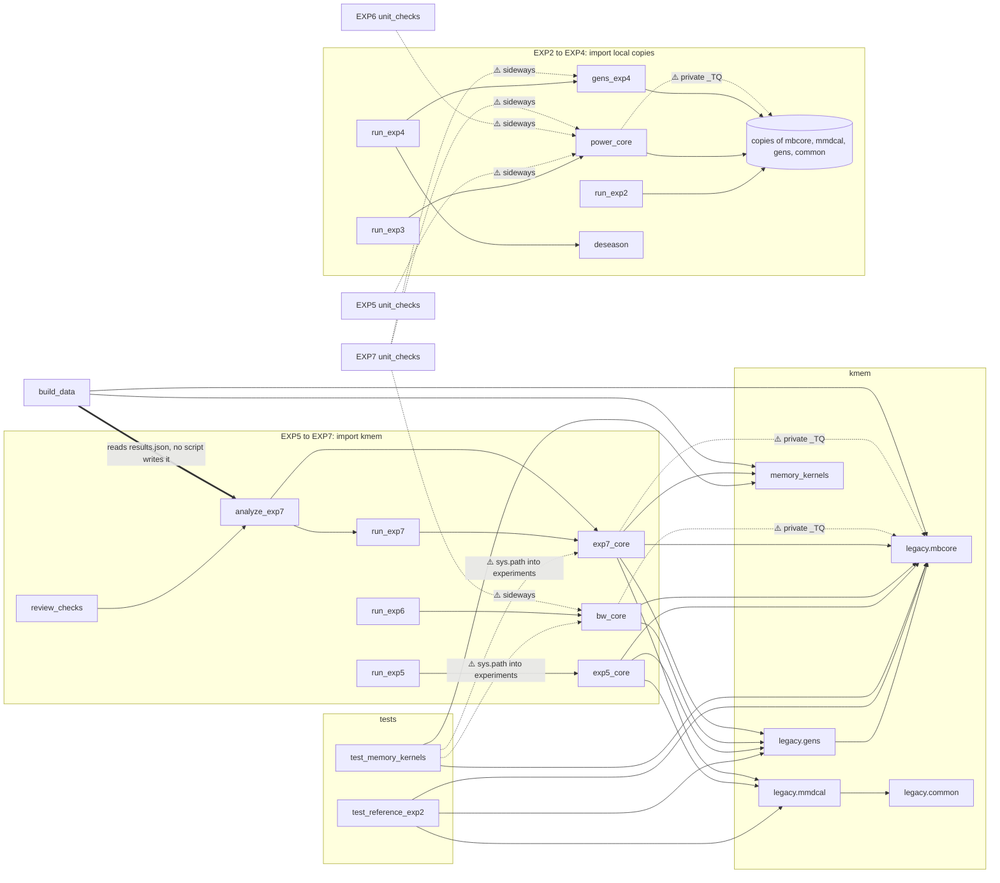
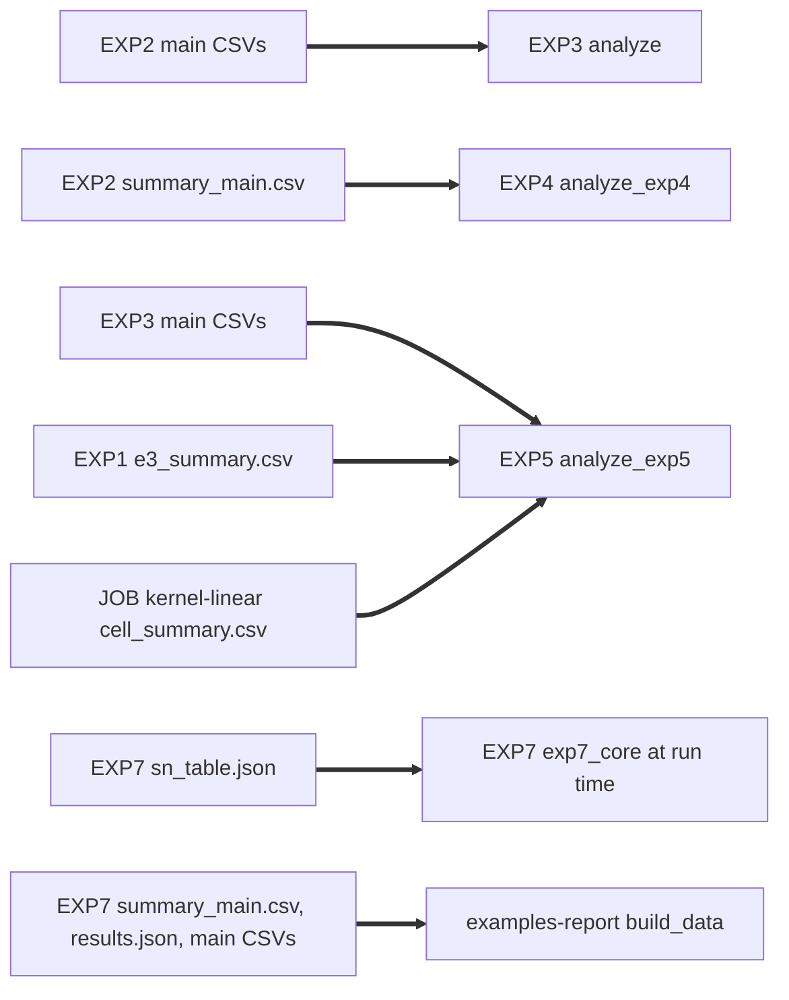
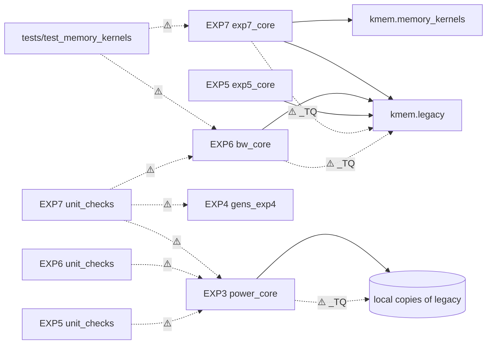

# Architecture Review Report

**Project:** TrackMB3_KernelTestsLongMemory (`kmem` package and experiment code)
**Date:** 2026-11-03
**Files reviewed:** 71 Python files and 7 shell scripts, about 15,000 lines. 3,481 of those lines are byte-identical copies of `kmem/legacy`.
**Overall health:** 🟠 Weak

**Method notes.**
- This review follows `~/.claude/skills/review-architecture/SKILL.md`. The shared principles file is not at `~/.claude/skills/shared-principles.md`. The review used `/home/ak/blueprint/shared-principles.md` instead.
- No pressure pack applies. The two packs in `/home/ak/blueprint/principles/` name `design` and `refactor` only.
- The user asked for `/blueprint`. No skill by that name is installed. The "Blueprint" section below is the skill's Step 1 ingestion, and it stands in for `/blueprint`.
- The review is read-only. It ran the existing tests once and ran no experiment.

---

## Blueprint (Step 1 ingestion, stands in for /blueprint)

### 1. Directory tree (in-scope code only)

```
kmem/
  __init__.py                 version string, "new code must pass the EXP2 reference test"
  memory_kernels.py           pure Gram-matrix maps used by EXP7          [untracked]
  legacy/                     frozen EXP2 core, pinned by tests/test_reference_exp2.py
    __init__.py  PROVENANCE.md
    mbcore.py   (379)         fGn/fOU, Gram helpers, wild/shift/subsample, kind_tests, lind_tests
    common.py   (186)         fGn, long-run variance, t quantiles, Wilson interval
    mmdcal.py   (271)         split-MMD calibrations, local Whittle, GPH, self-normalised test
    gens.py     (136)         EXP2 process features (HT, NL-SV, NL-TAR, SEAS)
tests/
  conftest.py                 pins BLAS to one thread before numpy loads
  test_reference_exp2.py      41 tests: 40 saved EXP2 rows reproduced exactly + numpy version
  test_memory_kernels.py      72 tests: memory kernels + EXP6/EXP7 fast paths   [untracked]
experiments/
  EXP1-20261016/              run_e1, run_e3, run_mmd, analyze, validate_mmdcal, e1_* (market data),
                              khom + copies of common, mbcore, mmdcal          [mostly untracked]
  EXP2-20261023/              run_exp2, analyze, unit_checks + copies of common, gens, mbcore, mmdcal
  EXP3-power-20261025/        run_exp3, power_core, analyze, unit_checks + the same four copies
  EXP4-deseason-20261025/     run_exp4, deseason, gens_exp4, analyze_exp4, unit_checks,
                              run_main.sh, run_topup.sh + copies of common, gens, mbcore
  EXP5-scaled-n-20261025/     run_exp5, exp5_core, analyze_exp5, unit_checks, run_*.sh (5 scripts)
  EXP6-bandwidth-20261025/    run_exp6, bw_core, analyze_exp6, unit_checks
  EXP7-memory-kernel-20261101/  run_exp7, exp7_core (883), analyze_exp7 (728), unit_checks,
                              sn_tables, layer_memory_check, review_checks, hcheck_repro,
                              results_tables, plot_growth                      [untracked]
investigations/memory-kernel-2026-11-01/
  theory_checks.py  (1521)    exact numeric checks of THEORY.md, no Monte Carlo [untracked]
  examples-report/            build_data -> make_numbers, make_figures (consumers of EXP7 outputs)
```

### 2. Module map

| Module | Responsibility in one sentence | Main public API | Project imports | Fan-in | Change rate |
|---|---|---|---|---|---|
| `kmem.legacy.mbcore` | Generators, Gram helpers, three HSIC/dCov calibrations and the Pearson tests used by EXP1 to EXP7. | `fgn`, `median_bandwidth`, `double_center`, `markov_rademacher`, `shift_stats`, `subsample_stats`, `kind_tests`, `lind_tests`, `_TQ` | none | 12 modules, plus 4 copies | static |
| `kmem.legacy.common` | fGn, long-run variance and interval helpers. | `wilson`, `nw_lrv`, `ewc_lrv`, `t_quantile_975` | none | `mmdcal`, 4 analysis scripts | static |
| `kmem.legacy.mmdcal` | Split-MMD calibration rules and memory estimators. | `rep_e2`, `multipliers`, `local_whittle_d`, `median_heuristic`, `B_WILD` | `common` | EXP3, EXP5, EXP7 cores, 2 EXP7 scripts, tests | static |
| `kmem.legacy.gens` | EXP2 process-feature generators. | `generate`, `pair`, `MAIN`, `PERIOD`, `SEAS_B` | `mbcore` | 5 cores, tests, EXP7 scripts | static |
| `kmem.memory_kernels` | Pure maps from a Gram matrix to a memory-reduced Gram matrix. | `increment`, `hermite_basis`, `hermite`, `highpass`, `fracdiff_features`, `even_map`, `first_difference` | none | `exp7_core`, tests, `build_data` | slow |
| `EXP3/power_core` | EXP3 generators plus re-typed HSIC and MMD bundles with 95% quantiles. | `ind_pair`, `mmd_series`, `kind_ext`, `mmd_ext` | local copies | `run_exp3`, unit checks of EXP3, EXP6, EXP7 | frozen after run |
| `EXP5/exp5_core` | Scaled-shift MMD bundle and its effect-size helpers. | `mmd_ext`, `sd_half`, `ind_rep` | `kmem.legacy` | `run_exp5`, `analyze_exp5`, `unit_checks` | frozen after run |
| `EXP6/bw_core` | HSIC bundle across bandwidth multipliers kappa. | `ind_pair`, `hsic_fields`, `kind_bw` | `kmem.legacy` | `run_exp6`, `analyze_exp6`, 2 unit-check scripts, tests | frozen after run |
| `EXP7/exp7_core` | Generators, low-rank fast path, ten kernels, multipliers, Harris, self-normalised and Hermite-split rules, and the bundles. | 51 top-level definitions | `kmem.memory_kernels`, `kmem.legacy` | `run_exp7`, `analyze_exp7`, 5 EXP7 scripts, tests | fast |
| `run_expN.py` (6 files) | Grid, seeds, resume, process pool, CSV writer and manifest for one experiment. | `cell_list`/`main_cells`, `run_chunk`, `main` | own core | own analysis and unit checks | frozen after run |
| `analyze*.py` (6 files) | Rejection rules, Wilson intervals, size-adjusted power, bootstraps, verdicts and tables. | `load`, `main`, rule tables | own runner and core | `review_checks` (EXP7) | fast |
| `examples-report/build_data.py` | Report numbers recomputed from EXP7 outputs. | `main` | `kmem.memory_kernels`, `kmem.legacy.mbcore` | `make_numbers`, `make_figures` (by file) | fast |

### 3. Entry points

| Command (run inside the experiment folder) | What it does | Reads | Writes |
|---|---|---|---|
| `python -I run_exp2.py --mode main --reps 1000 --out main` | EXP2 simulation | nothing | `main/*.csv`, `main/manifest_*.json` |
| `python -I run_exp3.py ...`, `run_exp4.py`, `run_exp5.py`, `run_exp6.py`, `run_exp7.py` | EXP3 to EXP7 simulations, one driver each | EXP7 also reads `sn_table.json` | same layout |
| `run_main.sh`, `run_topup.sh` (EXP4), `run_main.sh`, `run_part1b.sh`, `run_part2.sh`, `run_part3.sh`, `run_pilot.sh` (EXP5) | Staged runs with waits on other processes and wall-clock cut-offs | logs | CSVs |
| `python -I analyze*.py` (6 files) | Summaries, verdicts, tables | own CSVs, and for EXP3, EXP4, EXP5 other experiments' outputs | `summary_*.csv`, `results_*.json`, `tables_*.md`, `verdicts_*.json` |
| `python -I unit_checks.py` (6 files) | Pre-registered numerical checks, not collected by pytest | other experiments' modules | `unit_checks.txt` |
| `sn_tables.py`, `layer_memory_check.py`, `review_checks.py`, `hcheck_repro.py`, `results_tables.py`, `plot_growth.py` (EXP7) | Prerequisite table and post-hoc checks | EXP7 outputs | CSV, JSON, PNG |
| `OMP_NUM_THREADS=4 python -I theory_checks.py` | Exact numeric checks of the theory | nothing | `theory_exact.csv`, `theory_exponents.csv` |
| `build_data.py`, then `make_numbers.py`, `make_figures.py` | Examples report | EXP7 `summary_main.csv`, `results.json`, `main/*.csv` | report data and figures |

### 4. Test catalogue

| Test | Count | What it covers | Notes |
|---|---|---|---|
| `tests/test_reference_exp2.py` | 41 | 40 saved EXP2 replications reproduced column by column through `kmem.legacy`, plus a numpy-version check | Reads the saved EXP2 manifest and CSVs. The only reproduction pin in the repo. |
| `tests/test_memory_kernels.py` | 72 | Every `memory_kernels` map against brute force; EXP7 fast path against `mbcore` and against EXP6 `hsic_fields` | Imports `exp7_core` and `bw_core` from experiment folders via `sys.path` (lines 18-21). Untracked. |
| `experiments/*/unit_checks.py` | 6 scripts | Pre-registered checks, cross-experiment equality (EXP6 vs EXP3, EXP7 vs EXP3, EXP4, EXP6) | Scripts, not tests. They write `unit_checks.txt`. |
| `EXP1/validate_mmdcal.py` | 1 script | `mmdcal` calibration checks | Writes `validate_mmdcal.PASS`. |

**Run result.** `PYTEST_DISABLE_PLUGIN_AUTOLOAD=1 python -I -m pytest tests -q` gives **113 passed in 7.9 s**. Without the environment variable, pytest crashes before collection. The installed `pytest_cov` plugin raises `TypeError: HookimplMarker.__call__() got an unexpected keyword argument 'wrapper'` under pytest 7.4.4. The variable is documented only in the docstring of `tests/test_reference_exp2.py:8`.

### 5. Configuration

- Each runner holds its configuration as module constants: `MASTER` seeds, grids, `CHUNK`, `B`, effect sizes (for example `run_exp7.py:36-52`).
- `argparse` flags select mode, reps, output folder and subsets. EXP6 and EXP7 add experiment-specific flags (`--kappas`, `--oracle-kappas`, `--extras-only`, `--reps4000`).
- No config file, `pyproject.toml`, `requirements.txt` or environment lock exists. All 32 saved main manifests record numpy 2.5.1 and Python 3.12.13, and the current interpreter matches.
- Each run writes `manifest_<stamp>.json` with masters, seed rule, numpy and Python versions, argv and the cell list with each cell's seed index. This is the best existing source of truth for reruns.

### 6. Import graph

Solid edges are imports. Dotted edges marked ⚠️ break dependency direction. Thick edges are file reads between folders.



Data lineage between folders (file reads, not imports):



---

## Codebase Summary

The repo runs Monte Carlo experiments on the false-alarm rate of kernel independence and two-sample tests under long memory. Each experiment (EXP1 to EXP7) is a self-contained folder. It holds a driver that builds a grid of cells and seeds every replication from `SeedSequence(master, (cell_index, rep))`. It also holds a `*_core.py` with that experiment's generators and test bundles, an analysis script, a `unit_checks.py` script, and the saved outputs. The validated statistical core (`mbcore`, `mmdcal`, `common`, `gens`) was frozen into `kmem/legacy` on 2026-10-25 (commits 28dd343, 84bf759) and is pinned by an exact reference test on 40 saved EXP2 rows. EXP2 to EXP4 still import their own byte-identical copies of that core. EXP5 to EXP7 import `kmem.legacy` and re-type parts of it with extra outputs. The only new package module is `kmem/memory_kernels.py`. The reusable EXP7 fast path, the calibration rules and the generators all live in experiment folders, and the package tests import them from there.

## Scorecard

| Dimension | Score | Key Finding |
|---|---|---|
| Boundary Quality | 🟠 | Domain concepts (generator, kernel, calibration rule, cell, runner) have no package modules. `exp7_core.py` holds all of them in 883 lines. |
| Dependency Direction | 🟠 | Package tests import experiment scripts. Experiments import each other sideways. Three modules read the private `mbcore._TQ` cache. |
| Abstraction Fitness | 🟠 | Cells are plain dicts, kernels and rules are strings, and the main bundle is steered by five boolean flags. |
| DRY & Knowledge | 🔴 | The HSIC and MMD bundles are re-typed in three experiments each, with drift in arithmetic order and names. The next experiment would copy them again. |
| Extensibility | 🔴 | A new kernel or calibration rule means editing six or more existing switch sites across three files. No command reruns a past experiment. |
| Testability | 🟠 | 113 fast tests pass, but only EXP2 is pinned to saved rows. EXP7 code is untracked. EXP1's driver changed after its run. |
| Parallelisation | 🟢 | Per-replication seeds make results independent of worker count, chunking and resumes. Row order and the analysis bootstrap stream are the only schedule effects. |

**Overall: 🟠 Weak.** The numerics are careful and well tested. The structure, however, makes every new kernel, rule or experiment a copy-and-edit job, and only one of six experiments can prove it still reproduces.

## Quick Constraint Checks

| Check | Result | Finding |
|---|---|---|
| Domain logic references files or infrastructure? | Yes. `exp7_core.sn_cut` loads `sn_table.json` from the EXP7 folder through a module global (`exp7_core.py:51-52`, `606-611`). | AR-DEP-002 |
| Mutable internals exposed? | Yes. `mbcore._TQ` is a module dict filled as a side effect of `lind_tests` (`kmem/legacy/mbcore.py:352`, `366-367`) and read by three other modules. | AR-DEP-002 |
| Domain objects constructible in invalid states? | Yes. Cells are plain dicts built differently by each runner. | AR-ABS-001 |
| Unit tests need the filesystem? | Only the reference test, by design: it reads saved golden rows. | none |
| Unit suite slower than 5 s? | 7.9 s. Four n = 2000 reference rows take 3.2 s of it. Acceptable for golden tests. | none |
| Swap a dependency without editing the module? | No. Kernels, generators and rules are chosen by string switches. | AR-EXT-001, AR-EXT-002 |
| New variant needs more than 2 files? | Yes. A kernel touches 3 files and about 10 sites. A rule touches 3 files and about 8 sites. | AR-EXT-001, AR-EXT-002 |
| Per-variant `if x ==` checks? | Yes. `exp7_core.py:370-389`, `399-420`, `762-775`, `846-861`. Also `run_exp7.py:136-149` on family. | AR-EXT-001 |
| Same magic numbers in several modules? | Yes. `ln = floor(n^0.5)`, `dn = A = floor(0.1 n)` in `mbcore.py:268-270`, `power_core.py:86-88`, `bw_core.py:96-98`, `exp7_core.py:721-722` and `274`. The 5% normal cut-off `1.959963984540054` in `mbcore.py:374`, `power_core.py:130`, `exp7_core.py:756`. | AR-DRY-002 |

## Rate-of-change Analysis

| Module group | Rate | Misalignment |
|---|---|---|
| `kmem/legacy/*` | static | None. Frozen and pinned. |
| `kmem/memory_kernels.py` | slow | None. Grows by one function per new kernel. |
| `experiments/*/*_core.py` | fast during an experiment, frozen after | Bundles slow knowledge (kernels, calibration rules, generators) with fast choices (alternatives, flags). The slow knowledge gets copied into each new experiment. |
| `experiments/*/run_exp*.py` | frozen after the run | Bundles static driver mechanics (resume, pool, writer, manifest) with the experiment's grid. The mechanics are copied six times. |
| `experiments/*/analyze*.py` | fast | Bundles static statistics (Wilson, c*, bootstrap, McNemar) with experiment verdicts. The statistics are copied five times. |

---

## Detailed Findings

Ordered by severity: 🔴, then 🟠, then 🟡.

### AR-DRY-002: Test bundles are re-typed in each experiment, and the copies drift
- **Finding ID:** AR-DRY-002
- **Dimension:** DRY & Knowledge
- **Severity:** 🔴
- **Location:** `kmem/legacy/mbcore.py:262-316` (source); `experiments/EXP3-power-20261025/power_core.py:83-132`; `experiments/EXP6-bandwidth-20261025/bw_core.py:66-138`; `experiments/EXP7-memory-kernel-20261101/exp7_core.py:697-780`. MMD: `power_core.py:137-176`, `exp5_core.py:65-105`, `exp7_core.py:804-814`.
- **Principle violated:** Knowledge duplication (same statistical rule in several places).
- **Evidence:** `power_core.kind_ext` docstring says "mbcore.kind_tests plus 95% reference quantiles. Same rng consumption order." It copies all 30 lines of arithmetic to add four quantiles. EXP6 and EXP7 repeat the pattern. The copies already drift. `kmem.memory_kernels.double_center` subtracts row means first (`memory_kernels.py:17-21`). The inline MMD copies subtract column means first (`power_core.py:156`, `exp5_core.py:85`, `exp7_core.py:811`). One alternative is called `"shift"` in `power_core.py:73` and `"mean"` in `exp7_core.py:165`.
- **Impact:** Each new experiment copies the bundle again, so debt compounds. A merge must keep both subtraction orders, or saved EXP3, EXP5 and EXP7 rows change in the last bits. Draw order is kept by hand in each copy.
- **Recommendation:** Move the bundle arithmetic into the package once, as composable statistic and calibration functions. Keep the two centring orders as two named variants. Let each experiment compose them rather than copy them.

### AR-EXT-001: Adding a kernel or a generator means editing existing string switches
- **Finding ID:** AR-EXT-001
- **Dimension:** Extensibility
- **Severity:** 🔴
- **Location:** Kernels: `exp7_core.py:41-43` (kernel tuples), `370-389` (`transform_features`), `399-420` (`gram_full`), `670-680` (`kernel_columns`), `762-775` (`ind_bundle` loop), `846-861` (`mmd_bundle` loop); `run_exp7.py:147`, `220-228`; `analyze_exp7.py:146-190`. Generators: `exp7_core.py:109-176`, `power_core.py:41-78`, `bw_core.py:41-61`, `exp5_core.py:56-62`; `kmem/legacy/gens.py` `MAIN` tuple (frozen).
- **Principle violated:** Open/Closed.
- **Evidence:** Extension scenario "add kernel herm3". It needs a new branch in three `exp7_core` switches, a tuple edit, a column rule, an analysis rule entry and a driver column list. That is 3 files and about 10 sites, all modifying existing logic. The Hermite order is parsed from the name with `int(kernel[-1])` at `exp7_core.py:379`, `415`, `850`, so `herm10` would silently become order 0. Extension scenario "add generator X". The legacy generator list is frozen, so a new generator goes into another `if gen == ...` cascade inside an experiment core.
- **Impact:** Every kernel or generator added risks breaking the existing ones and cannot be added without touching validated code paths.
- **Recommendation:** Give kernels and generators a small protocol and a registry. A kernel names its parameters explicitly and supplies its fast-path feature map and exact Gram map. Legacy generators get registered through wrappers, not edits.

### AR-EXT-002: A new calibration rule cuts across statistic code, column lists and analysis
- **Finding ID:** AR-EXT-002
- **Dimension:** Extensibility
- **Severity:** 🔴
- **Location:** `exp7_core.py:266-295` (`rules_fast`), `298-310` (`rules_full`), `355-367` (`rules_distance`), `478-514` (Harris), `670-680` (columns); `analyze_exp7.py:146-190` (rule tables); `analyze.py:24-43` in EXP2 and EXP3, `analyze_exp5.py:33-41`, `analyze_exp6.py:29-42`.
- **Principle violated:** Open/Closed, Single Responsibility.
- **Evidence:** Extension scenario "add a block bootstrap". Each `rules_*` function computes the statistic and all rules together and returns one dict. The rule must be added to three statistic paths, the column list and every analysis rule table. The rejection rule for one column lives in the runner (p-value) and again in each analysis (threshold).
- **Impact:** The five planned rule families (wild, circular shift, Harris shift, subsampling, self-normalised) cannot be mixed with new kernels without editing both. Analysis and runner can disagree on what "reject" means.
- **Recommendation:** Separate "compute the statistic and its null draws" from "turn draws into p-values, ratios and rejections". Let one rule object own its columns and its reject function, used by both the runner and the analysis.

### AR-EXT-004: No command reruns a past experiment, and some runs cannot be replayed from scripts
- **Finding ID:** AR-EXT-004
- **Dimension:** Extensibility
- **Severity:** 🔴
- **Location:** `experiments/EXP5-scaled-n-20261025/run_part3.sh:5-10`; `run_part1b.sh`, `run_part2.sh`; `experiments/EXP6-bandwidth-20261025/run_exp6.py:5`, `81`; EXP4 `run_main.sh`, `run_topup.sh`; `exp7_core.py:51` (`sn_table.json` prerequisite); `investigations/.../examples-report/build_data.py:337`.
- **Principle violated:** Configuration separate from behaviour. Reproducible entry point.
- **Evidence:** EXP5 Part 3 runs n = 8000 stages only if the UTC clock reads before 21:25 or 21:35 (`run_part3.sh:9-10`). A rerun at another hour writes no n = 8000 rows and reports no error. EXP6's documented command uses `--reps 1000` (`run_exp6.py:5`), but the saved run used 500 reps and oracle kappas 0.25 and 8 (saved manifest argv, DESIGN.md:146-150). `--oracle-kappas` defaults to empty (`run_exp6.py:81`). EXP7 needs `sn_tables.py` to run first. No script writes `EXP7/results.json`, yet `build_data.py:337` reads it. The same holds for EXP6 `results.json` and `regression_vs_exp3.txt`. Analyses read other experiments' outputs through hard-coded relative paths (`EXP3 analyze.py:22`, `analyze_exp4.py:20`, `analyze_exp5.py:25-27`).
- **Impact:** "Rerun EXP5" today means reading logs and DESIGN amendments. A scripted rerun can silently differ from the saved run. Upstream inputs are implicit.
- **Recommendation:** Describe each past run as data: final per-cell targets, flags, prerequisites and upstream inputs, derived from the saved manifests. Drive every run and every reproduction check from that description through one command.

### AR-BND-001: The package has no modules for the domain concepts
- **Finding ID:** AR-BND-001
- **Dimension:** Boundary Quality
- **Severity:** 🟠
- **Location:** `kmem/` (only `legacy/` and `memory_kernels.py`); `experiments/EXP7-memory-kernel-20261101/exp7_core.py:1-883`.
- **Principle violated:** Single Responsibility, rate-of-change alignment.
- **Evidence:** `exp7_core.py` holds 51 top-level definitions: generators (74-176), bandwidth (179-206), low-rank features (208-264), three rule paths (266-367), kernel maps (370-420), multipliers (425-447), Harris (452-514), self-normalised tests (518-617), Hermite split (620-661), bundles and column lists (666-883). Its docstring calls it "generators, memory-kernel rule bundles, and a low-rank fast path". The general-purpose fast path, which the next experiment would need, sits in an experiment folder.
- **Impact:** The reusable parts cannot be imported without importing one experiment's grid choices. Reviewers cannot see which parts are validated library code and which are EXP7 choices.
- **Recommendation:** Give the package one module per domain concept: generators, kernels, statistics and features, calibration rules, cells and specs, runner, analysis. Keep experiment folders for specs, design notes, outputs and thin compositions.

### AR-DEP-001: Tests and experiments import across folder boundaries through sys.path
- **Finding ID:** AR-DEP-001
- **Dimension:** Dependency Direction
- **Severity:** 🟠
- **Location:** `tests/test_memory_kernels.py:18-21`; `experiments/EXP5-scaled-n-20261025/exp5_core.py:19-21`; `EXP5 unit_checks.py:23-37`; `EXP6 unit_checks.py:20`; `EXP7 unit_checks.py:29-36`; `run_exp7.py:30-31`; `build_data.py:22`.
- **Principle violated:** Dependency Inversion. Package code must not depend on experiment scripts.
- **Evidence:** The package's own test file inserts the EXP6 and EXP7 folders into `sys.path` and imports `bw_core` and `exp7_core`. A library module (`exp5_core.py:19-21`) edits `sys.path` at import. EXP7's unit checks import EXP3 `power_core`, EXP4 `gens_exp4` and EXP6 `bw_core`. `import gens` resolves by path order, so EXP4's `gens_exp4` picks up EXP3's copy of `gens` there. EXP7 `unit_checks.py` has 7 project imports, above the fan-out threshold of 5. The graph has no cycles.
- **Impact:** Moving or renaming an experiment folder breaks package tests. Import results depend on path order.
- **Recommendation:** Install `kmem` as a package. Move every module imported by more than one folder into it. Make experiments depend on the package only, never on each other.

### AR-ABS-001: Cells, kernels and rules are untyped, and the main bundle is flag-driven
- **Finding ID:** AR-ABS-001
- **Dimension:** Abstraction Fitness
- **Severity:** 🟠
- **Location:** `run_exp2.py:47-57`, `run_exp5.py:51-78`, `run_exp6.py:46-56`, `run_exp7.py:55-115`; `exp7_core.py:710-712`; `bw_core.py:66`.
- **Principle violated:** Missing abstraction (data clumps, primitive obsession, flag arguments).
- **Evidence:** Each runner builds cells as dicts with different keys (`H` vs `HX`/`HY`, `c`, `delta`, `sumH`, `param`, `target`). Names are rebuilt from f-strings in analyses and the report (`build_data.py:257-260` copies `run_exp7.py:113-115`). `ind_bundle` takes `exact, full, hsplit, dist, strict`, and no caller passes `dist`. `hsic_fields(x, y, dx, dy, sx, sy, w, n, ln, dn, A)` carries the `(n, ln, dn, A)` clump. There is no protocol for kernel, generator or calibration rule. Two good seeds exist: the `Multipliers` class (`exp7_core.py:425-447`) and the `(kernel, rule, column, reject_fn)` table in `analyze_exp7.py:146-166`.
- **Impact:** Invalid cells can be built. Every consumer must re-learn each experiment's dict layout. Flag combinations multiply untested paths.
- **Recommendation:** Introduce a typed cell, a typed experiment spec, and narrow protocols for kernel, generator and calibration rule. Grow the analysis rule table into the shared rule registry.

### AR-DRY-001: The frozen core exists in five byte-identical copies, and EXP1 to EXP4 import the copies
- **Finding ID:** AR-DRY-001
- **Dimension:** DRY & Knowledge
- **Severity:** 🟠
- **Location:** `kmem/legacy/{common,mbcore,mmdcal,gens}.py`; copies in `experiments/EXP1-20261016/`, `EXP2-20261023/`, `EXP3-power-20261025/`, `EXP4-deseason-20261025/`; imports at `run_exp2.py:25-30`, `power_core.py` imports, `run_exp4.py`, `gens_exp4.py`.
- **Principle violated:** Single source of truth.
- **Evidence:** md5 sums match across all copies (3,481 lines). `mmdcal.py` and `gens.py` in `kmem/legacy` differ only by one relative-import line each, as `kmem/legacy/PROVENANCE.md` documents. EXP2 to EXP4 runners insert their own folder into `sys.path` and import the local copy.
- **Impact:** The package is not the single source the reference test protects. Duplicate module names (`gens`, `mbcore`) collide on `sys.path`.
- **Recommendation:** Point EXP1 to EXP4 at `kmem.legacy` and retire the copies. Keep the provenance through a hash test, not through duplicate files.

### AR-DRY-003: Analysis knowledge is re-declared per experiment
- **Finding ID:** AR-DRY-003
- **Dimension:** DRY & Knowledge
- **Severity:** 🟠
- **Location:** Rule tables: `EXP2 analyze.py:24-35`, `EXP3 analyze.py:28-43`, `analyze_exp4.py:27`, `analyze_exp5.py:33-41`, `analyze_exp6.py:29-42`, `analyze_exp7.py:146-190`, `build_data.py:263-268`. Wilson: `kmem/legacy/common.py:179`, `EXP1 analyze.py:23`, `analyze_exp6.py:54`, `analyze_exp7.py:105`, `layer_memory_check.py:130`, `build_data.py:219`.
- **Principle violated:** Knowledge duplication.
- **Evidence:** The rejection rule "p_wb <= 0.05" is written in seven places. Wilson intervals appear six times. `build_data.py:219` lacks the `m == 0` guard that `analyze_exp7.py:106` has. Long analysis mains fuse loading, regression, bootstrap and writing (`EXP3 analyze.py:95-271`, `analyze_exp6.py:116-253`, `analyze_exp7.py:544-655`).
- **Impact:** The report and the analysis can disagree on what was rejected. Each new experiment copies the helpers again.
- **Recommendation:** Collect interval, size-adjustment, McNemar and size-class helpers in one package module. Derive rejection rules from the calibration-rule registry for new experiments.

### AR-DRY-004: The driver skeleton is copied six times, and the resume rule diverged
- **Finding ID:** AR-DRY-004
- **Dimension:** DRY & Knowledge
- **Severity:** 🟠
- **Location:** `run_exp2.py:81-136`, `run_exp3.py:111-166`, `run_exp4.py:106-163`, `run_exp5.py:102-154`, `run_exp6.py:74-138`, `run_exp7.py:173-246`. Resume: `run_exp2.py:102-105`, `run_exp3.py:133-136`, `run_exp5.py:121-124`, `run_exp6.py:102-108` versus `run_exp4.py:51-57`, `run_exp7.py:166-170`.
- **Principle violated:** Knowledge duplication. Shotgun surgery.
- **Evidence:** All six drivers repeat the BLAS pin, task building, manifest, fork pool and CSV append. EXP4 and EXP7 count a replication as done only with a complete `status == "ok"` row. EXP2, EXP3, EXP5 and EXP6 count any row, including error rows and rows truncated by a crash. Only EXP6 checks the header before appending. EXP7 alone writes floats at 12 significant digits (`run_exp7.py:157-163`).
- **Impact:** The resume bug fixed in commit 4c81f9d reached two drivers. A seventh experiment will copy one of the six variants.
- **Recommendation:** One driver in the package, configured by the experiment spec, with the strict resume rule and the writer format recorded in the manifest.

### AR-EXT-003: A cell's seed is its position in a list
- **Finding ID:** AR-EXT-003
- **Dimension:** Extensibility
- **Severity:** 🟠
- **Location:** `run_exp2.py:54-56`, `run_exp7.py:104-107`, `run_exp5.py:63-67`, `run_exp6.py:43`, `50`; `run_exp3.py:32`, `run_exp4.py:38`.
- **Principle violated:** Hidden coupling between grid order and random streams.
- **Evidence:** Each runner seeds replication `r` of cell `c` with `SeedSequence(master, (c["idx"], r))`, and `idx` is the cell's list position. EXP7 documents "append-only" (`run_exp7.py:60`). EXP5 starts the independence family at a hand-picked `k = 100`. EXP6 copies EXP3 positions by hand (`EXP3_IDX = [0, 2, 6, 18, 24, 30]`). EXP3 and EXP4 share master seeds and stay distinct only because EXP4 adds a third spawn-key element. No registry of masters exists.
- **Impact:** Inserting a generator or an H value in the middle of a grid silently changes the seeds of every later cell. A new experiment can reuse a master by accident.
- **Recommendation:** Store each cell's seed index explicitly in the spec. For past experiments, take it from the saved manifests. Keep one registry of master seeds with a uniqueness check.

### AR-TST-001: Only EXP2 can prove it still reproduces, and some producing code is unpinned
- **Finding ID:** AR-TST-001
- **Dimension:** Testability
- **Severity:** 🟠
- **Location:** `tests/test_reference_exp2.py:1-88`; `git status` (untracked `experiments/EXP7-memory-kernel-20261101/`, `kmem/memory_kernels.py`, `tests/test_memory_kernels.py`, most of EXP1); `experiments/EXP1-20261016/manifest.json:71`.
- **Principle violated:** Module boundaries need tests. A refactor needs a safety net first.
- **Evidence:** The reference test pins 40 EXP2 rows. EXP3 to EXP7 have no saved-row pin. EXP7 produced 166,400 rows (43.8 CPU-hours), and none of its code is in git. EXP1's manifest records `run_e1.py` with sha256 `ef5f7e5c…`, but the file now hashes to `08308ecb…`. The `unit_checks.py` scripts are not collected by pytest.
- **Impact:** A refactor of EXP3 to EXP7 code has no automatic check that saved results still reproduce. An accidental edit to EXP7 code could not be detected or undone.
- **Recommendation:** Put the producing code under version control first. Generalise the EXP2 reference test to sampled saved rows of every experiment before any code moves.

### AR-DEP-002: Hidden global state crosses module boundaries
- **Finding ID:** AR-DEP-002
- **Dimension:** Dependency Direction
- **Severity:** 🟡
- **Location:** `kmem/legacy/mbcore.py:352`, `366-367`; `power_core.py:131`; `bw_core.py:137`; `exp7_core.py:757`; `exp7_core.py:51-52`, `606-611`.
- **Principle violated:** Encapsulation. Explicit dependencies.
- **Evidence:** Three modules read `mb._TQ[nu]`, a private dict that only `lind_tests` fills as a side effect. The value is correct only because `lind_tests` runs first. `exp7_core.sn_cut` loads `sn_table.json` from the EXP7 folder through a module global.
- **Impact:** Reordering calls raises `KeyError`. The self-normalised rule cannot be reused outside the EXP7 folder.
- **Recommendation:** Get the t quantile through a public function. Pass the table path to the self-normalised rule explicitly.

### AR-TST-002: The test environment is not reproducible from the repo
- **Finding ID:** AR-TST-002
- **Dimension:** Testability
- **Severity:** 🟡
- **Location:** repo root (no `pyproject.toml` or lock); `pytest.ini`; `tests/test_reference_exp2.py:8`, `86-88`; `experiments/EXP4-deseason-20261025/unit_checks.py:10-11`; `investigations/memory-kernel-2026-11-01/theory_checks.py:3`.
- **Principle violated:** Reproducible build.
- **Evidence:** `python -I -m pytest tests -q` crashes at plugin load. Exact reproduction needs numpy 2.5.1, which only a test asserts. EXP4 `unit_checks.py` imports numpy without pinning BLAS. `theory_checks.py` documents a run with 4 OpenMP threads, which the conftest says changes last bits.
- **Impact:** A fresh machine cannot recreate the environment the reference test needs. Saved check outputs may not regenerate bit for bit.
- **Recommendation:** Declare the package and pinned dependencies. Make the documented test command work as written. Pin threads in every script that writes a saved output.

### AR-PAR-001: Row order and the analysis bootstrap depend on scheduling and cell set
- **Finding ID:** AR-PAR-001
- **Dimension:** Parallelisation
- **Severity:** 🟡
- **Location:** `run_exp2.py:122-132` and the five other drivers (`imap_unordered`); `analyze_exp7.py:703-711`; `EXP3 analyze.py:109`, `150-151`; `analyze_exp6.py:148`, `186-187`.
- **Principle violated:** Determinism of outputs.
- **Evidence:** Drivers append rows in completion order, and every row stores `cpu_s`. So per-cell CSVs are never byte-identical across runs, even though values are. The EXP7 analysis draws every cell's bootstrap from one `default_rng(SEED)` stream in cell order. Adding or removing one cell shifts every later interval.
- **Impact:** "Reproduce exactly" must be defined as value equality sorted by replication. Analysis outputs reproduce only with the identical cell set.
- **Recommendation:** Compare runs by value, sorted by replication, with timing columns excluded. Derive bootstrap streams per cell for new analyses, and keep the shared stream for past ones so their saved intervals still reproduce.

---

## Positive Highlights

1. **Seed discipline is excellent.** Each replication gets its own `SeedSequence(master, (cell, rep))` stream. Values do not depend on worker count, chunking, resumes or top-ups. Every EXP2 to EXP7 driver pins BLAS to one thread before numpy loads.
2. **The reference test is the right pattern.** `tests/test_reference_exp2.py` takes cell indices and masters from the saved manifest, not from code, and compares every output column. It runs in seconds. Generalising it is the cheapest safety net for the refactor.
3. **`kmem/memory_kernels.py` is a model package module.** It is pure, has no I/O, documents its algebra, and every map is tested against an explicit matrix in `tests/test_memory_kernels.py`.
4. **EXP7 cross-checks its own fast path.** The exact, fast and distance paths compute the same rules, and the first replications of each cell store both, so drift would show in the saved data.
5. **Failures are recorded, not hidden.** Error rows keep their message. Manifests record argv, versions and seeds. DESIGN amendments disclose deviations.

Preserve these five properties through the refactor.

## Recommended Review Cadence

Re-run this review when the first new experiment (EXP8) is built on the refactored package. That is the moment the extension points get their first real use. Re-run it also before adding a second new kernel family or calibration rule family.

## Handoff

### Scorecard

| Dimension | Score | Key Finding |
|---|---|---|
| Boundaries | 🟠 | No package modules for generator, kernel, rule, cell or runner. `exp7_core.py` holds all of them. |
| Dependencies | 🟠 | Package tests import experiment scripts. Experiments import each other. Private `_TQ` read from three modules. |
| DRY | 🔴 | HSIC and MMD bundles re-typed in three experiments each, with drift. Driver and analysis helpers copied. |
| Extensibility | 🔴 | New kernel or rule edits about 10 existing sites. No one-command rerun. List position sets seeds. |
| Testability | 🟠 | Only EXP2 pinned to saved rows. EXP7 code untracked. EXP1 driver drifted. Environment unpinned. |
| Abstraction | 🟠 | Dict cells, string kernels, flag-driven bundle, no protocols. |
| Parallelisation | 🟢 | Seeds independent of scheduling. Row order and shared analysis bootstrap are the only schedule effects. |

### Findings

| Finding ID | Severity | Dimension | Location | Summary |
|---|---|---|---|---|
| AR-DRY-002 | 🔴 | DRY | `power_core.py:83-176`, `bw_core.py:66-138`, `exp5_core.py:65-105`, `exp7_core.py:697-814` | The HSIC/dCov and MMD bundles are re-typed per experiment with hand-kept draw order. Centring order and alternative names already drift. |
| AR-EXT-001 | 🔴 | Extensibility | `exp7_core.py:41-43`, `370-420`, `670-680`, `762-775`, `846-861`; generator cascades in each core | A new kernel or generator edits about 10 existing switch sites in 3 files. Hermite order is parsed from the name. |
| AR-EXT-002 | 🔴 | Extensibility | `exp7_core.py:266-367`, `478-514`; `analyze_exp7.py:146-190`; analysis rule tables in EXP2 to EXP6 | Calibration rules are fused with statistic code and re-stated in each analysis. A new rule edits all of them. |
| AR-EXT-004 | 🔴 | Extensibility | `EXP5 run_part3.sh:9-10`, `run_exp6.py:5`, `81`, EXP4 shell scripts, `build_data.py:337` | No command reruns a past experiment. EXP5 depends on wall-clock time, EXP6 docs differ from the run, and some outputs have no writer. |
| AR-BND-001 | 🟠 | Boundaries | `kmem/`, `exp7_core.py:1-883` | Reusable domain code lives in experiment folders. One 883-line module mixes ten concerns. |
| AR-DEP-001 | 🟠 | Dependencies | `tests/test_memory_kernels.py:18-21`, `exp5_core.py:19-21`, EXP5 to EXP7 `unit_checks.py` | Package tests and experiments import experiment modules via `sys.path`. Same-named modules collide. |
| AR-ABS-001 | 🟠 | Abstraction | runners' cell builders, `exp7_core.py:710-712`, `bw_core.py:66` | Cells are ad hoc dicts, kernels and rules are strings, and the bundle takes five flags (one unused). |
| AR-DRY-001 | 🟠 | DRY | `experiments/EXP1..EXP4/{common,mbcore,mmdcal,gens}.py` | Five byte-identical copies of the frozen core. EXP1 to EXP4 import the copies, not `kmem.legacy`. |
| AR-DRY-003 | 🟠 | DRY | analysis rule tables (7 sites), Wilson (6 sites), `build_data.py:219` | Rejection rules and interval helpers are re-declared per experiment and already drift. |
| AR-DRY-004 | 🟠 | DRY | `run_exp2.py:81-136` and five other drivers | Driver mechanics copied six times. The strict resume rule reached two of them. |
| AR-EXT-003 | 🟠 | Extensibility | `run_exp2.py:54-56`, `run_exp5.py:63-67`, `run_exp6.py:43-50`, `run_exp3.py:32`, `run_exp4.py:38` | Seed index equals list position. Inserting a cell reseeds later cells. No master-seed registry. |
| AR-TST-001 | 🟠 | Testability | `tests/test_reference_exp2.py`, untracked EXP7 and kernels, `EXP1 manifest.json:71` | Only EXP2 rows are pinned. EXP7 code is untracked. EXP1's driver no longer matches its manifest hash. |
| AR-DEP-002 | 🟡 | Dependencies | `mbcore.py:352`, `366-367`; `power_core.py:131`, `bw_core.py:137`, `exp7_core.py:757`, `606-611` | Private `_TQ` cache read across modules, filled by side effect. SN table loaded from a fixed folder via a global. |
| AR-TST-002 | 🟡 | Testability | repo root, `pytest.ini`, `EXP4 unit_checks.py:10-11`, `theory_checks.py:3` | No package or lock file. The plain pytest command crashes at plugin load. Two scripts do not pin BLAS. |
| AR-PAR-001 | 🟡 | Parallelisation | six drivers (`imap_unordered`), `analyze_exp7.py:703-711`, `EXP3 analyze.py:150-151`, `analyze_exp6.py:186-187` | Row order and `cpu_s` block byte-identical CSVs. Analysis bootstraps share one stream across cells. |

### Dependency graph


