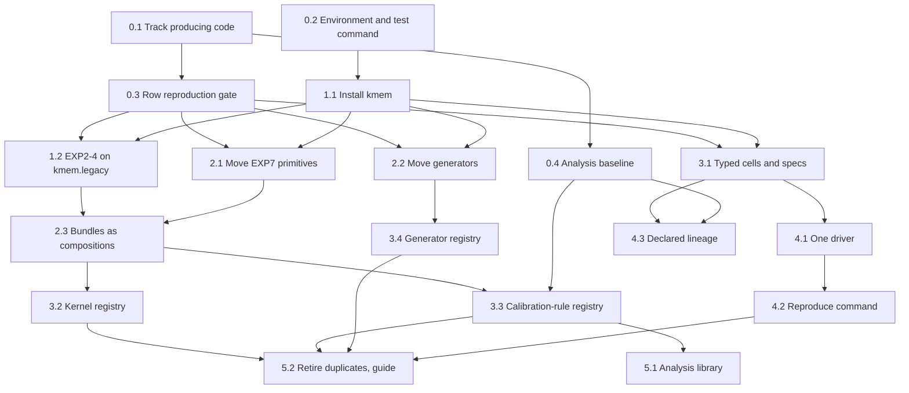
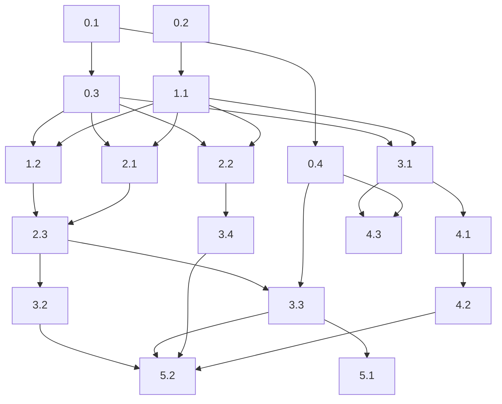

# Refactoring Roadmap

**Project:** TrackMB3_KernelTestsLongMemory (`kmem` package and experiments EXP2 to EXP7)
**Date:** 2026-11-03
**Findings consolidated:** 46 IDs (15 `AR-*`, 31 `CR-*`) into 18 steps in 6 phases
**Inputs:** the `## Handoff` sections of `reviews/2026_11_03_architecture_review.md` and `reviews/2026_11_03_code_review.md`
**Status of this document:** a plan only. No code has changed. The user confirms it before any step starts.

---

## Plain-English Summary

**The short answer.** The maths is sound. The structure is not. Each experiment copies the test code, the driver and the analysis helpers from the one before. Adding a kernel or a calibration rule means editing about ten places. Only EXP2 has a test that proves its saved results still reproduce.

**What the plan does.** It works in six phases. Each phase leaves everything runnable.

1. **Safety net first.** Put the untracked code in git. Build a test that reruns a sample of saved rows from every experiment and checks they match exactly.
2. **One copy of the frozen core.** Make every experiment import `kmem.legacy`. Stop editing `sys.path`.
3. **Move shared code into the package.** Move it without changing any arithmetic.
4. **Add extension points.** Kernels, generators and calibration rules each get a small registry. A new one becomes one new file.
5. **One command.** `kmem run` runs any experiment from a spec file. `kmem reproduce EXPn` checks a past experiment against its saved rows.
6. **Clean up.** Share the analysis helpers and write the "how to add X" guide.

**The safety rule.** After every step, a sample of saved rows from EXP2 to EXP7 must reproduce exactly. `kmem/legacy` must keep the same bytes. The tests must pass.

**Effort.** About 80 hours of work, give or take half. Phase 0 alone is about 12 hours, and it pays off at once.

**What you decide first.** Five questions, listed under "Decisions needed". The first is whether to commit the untracked EXP7 code now.

---

## Executive Summary

The current state is a validated, frozen core plus six experiment folders that each re-implement drivers, bundles and analysis helpers. EXP7 code is untracked, and only EXP2 is pinned to saved rows. The target is a `kmem` package with one module per domain concept, protocol-based registries for kernels, generators and calibration rules, typed experiment specs built from the saved manifests, and one command that runs or reproduces any experiment. The path starts with a reproduction safety net, then moves code without changing arithmetic, then adds extension points behind that net.

## Scorecard (from review)

| Dimension | Score | Key Finding |
|---|---|---|
| Boundaries | 🟠 | No package modules for generator, kernel, rule, cell or runner. `exp7_core.py` holds all of them. |
| Dependencies | 🟠 | Package tests import experiment scripts. Experiments import each other. Private `_TQ` read from three modules. |
| DRY | 🔴 | HSIC and MMD bundles re-typed in three experiments each, with drift. |
| Extensibility | 🔴 | A new kernel or rule edits about 10 existing sites. No one-command rerun. |
| Testability | 🟠 | Only EXP2 pinned to saved rows. EXP7 code untracked. |
| Abstraction | 🟠 | Dict cells, string kernels, flag-driven bundle. |
| Parallelisation | 🟢 | Seeds independent of scheduling. |

## Consolidated Findings

Findings at the same location are merged into one problem. Each row is one plan step.

| Step | Finding IDs | Problem | Source | Severity | Dimension |
|---|---|---|---|---|---|
| 0.1 | AR-TST-001, CR-022, CR-030 | Producing code untracked (EXP7) or drifted (EXP1) | both | 🔴 | Testability |
| 0.2 | AR-TST-002, CR-015 | Environment unpinned, test command crashes, two scripts skip BLAS pinning | both | 🟠 | Testability |
| 0.3 | AR-TST-001, CR-018, CR-021, CR-025 | No reproduction pin beyond EXP2, and no definition of "exact" | both | 🟠 | Testability |
| 0.4 | AR-PAR-001, CR-010, CR-029 | Unknown which analysis outputs regenerate. Some have no writer. | both | 🟠 | Testability |
| 1.1 | AR-DEP-001, CR-012 | `sys.path` edits in library code and tests | both | 🟠 | Dependencies |
| 1.2 | AR-DRY-001, CR-011 | EXP2 to EXP4 import local copies of the frozen core | both | 🟠 | DRY |
| 2.1 | AR-BND-001, AR-DEP-001, AR-DEP-002, CR-012, CR-013 | Reusable EXP7 primitives live in an experiment. Hidden globals. | both | 🟠 | Boundaries |
| 2.2 | AR-DRY-002, CR-004 | Generators copied three times with name drift | both | 🟠 | DRY |
| 2.3 | AR-DRY-002, CR-001, CR-005, CR-013, CR-020 | Test bundles re-typed, two centring orders, same-name algorithms | both | 🔴 | DRY |
| 3.1 | AR-ABS-001, AR-EXT-003, CR-008, CR-016, CR-017 | Untyped cells, seed equals list position, no master registry | both | 🟠 | Abstraction |
| 3.2 | AR-EXT-001, CR-006 | Kernel chosen by string switches | both | 🔴 | Extensibility |
| 3.3 | AR-EXT-002, AR-DRY-003, CR-007, CR-019 | Rules fused with statistics and re-stated in each analysis | both | 🔴 | Extensibility |
| 3.4 | AR-EXT-001, CR-004 | Generator chosen by `if gen ==` cascades | both | 🔴 | Extensibility |
| 4.1 | AR-DRY-004, AR-PAR-001, CR-002, CR-003, CR-014, CR-021 | Six drivers, divergent resume rule, unrecorded writer format | both | 🟠 | DRY |
| 4.2 | AR-EXT-004, CR-024, CR-025, CR-026, CR-028, CR-030 | No command reruns a past experiment | both | 🔴 | Extensibility |
| 4.3 | AR-EXT-004, CR-009, CR-029 | Inputs between experiments are implicit and skipped silently | both | 🟠 | Extensibility |
| 5.1 | AR-DRY-003, AR-PAR-001, CR-007, CR-010 | Analysis helpers copied. Bootstrap stream shared across cells. | both | 🟠 | DRY |
| 5.2 | AR-BND-001, AR-DRY-002, CR-001, CR-017 | Shims and duplicate cores remain. No extension guide. | both | 🟠 | Boundaries |

Deferred IDs (see "What This Plan Does NOT Address"): CR-023, CR-027, CR-031, and the analysis-verdict parts of CR-024 and CR-028.

No `TODO`, `FIXME` or `HACK` comments exist in scope.

---

## The Reproduction Gates

"Exact" needs a definition first. Byte-identical files are impossible today. Every row stores CPU time, and rows land in completion order (CR-021). So the plan uses **value-exact** reproduction (decision D3).

| Gate | When | Passes when |
|---|---|---|
| **G-legacy** | every step | `sha256sum kmem/legacy/*.py` equals the baseline below. |
| **G-unit** | every step | `python -I -m pytest tests -q` passes (113 tests today, plus new ones). |
| **G-rows** (the exact reproduction gate) | fast tier every step, slow tier at each phase end | For each of EXP2 to EXP7, a fixed, committed list of saved (cell, rep) pairs is recomputed from the seeds in that experiment's saved manifest. Every non-timing column must equal the saved value: `float(saved) == float(new)`, or both NaN, or equal text for strings and ints. EXP7 values pass through `run_exp7.fmt` first, because EXP7 wrote 12 significant digits. Excluded columns: `cpu_s`, `error`, and EXP4 `reused` (CR-025). |
| **G-analysis** | steps that touch analysis, and each phase end | Each analysis script, rerun on the saved raw CSVs in a scratch copy, writes byte-identical outputs. CPU-time fields are masked. This applies to the outputs that regenerate at the step 0.4 baseline. |
| **G-full** (optional, D4) | end of Phase 4 | One whole experiment, rerun through `kmem reproduce --full`, matches every saved row under the G-rows comparison. |

**G-legacy baseline (2026-11-03):**

```
0ed009c55c58438a58d7e793082a73b85e33cc6702cfa4f13bac5bef1852e2c1  kmem/legacy/common.py
3c6e3b8b46ac2faba56352a192d00508e010f7cf6456d0564e97800de3d3aea6  kmem/legacy/gens.py
8664bd0bd33c1b5b40dffede4e0b516ccf54db1c02379911adb959de8fcdf198  kmem/legacy/__init__.py
9c1a3d4af589f5cd2d3cef3433d2988f3085752c1e28eab9317977b61b5e6643  kmem/legacy/mbcore.py
29d20ef075c40660da6b989adc989410b7d5caabc68e22be8529474d256be9fc  kmem/legacy/mmdcal.py
```

**G-rows sizing.** The saved `cpu_s` columns give the cost per row. n = 500 rows cost 0.05 to 0.3 CPU-seconds. n = 2000 rows cost 0.2 to 5. n = 4000 rows cost about 7, and n = 8000 rows about 22. A fast tier of about 40 rows per experiment, mostly n = 500 plus a few n = 2000, costs under 5 CPU-minutes. The slow tier adds one row at each n ≥ 4000.

**Full rerun cost, for reference.** EXP2 26.4, EXP3 9.9, EXP4 8.8, EXP5 8.4, EXP6 4.3 and EXP7 43.8 CPU-hours, about 102 in total.

---

## Priority Scoring

Priority score = Impact × 2 − Scope − Risk. Dependencies override the score.

| Step | Impact | Scope | Risk | Score | Load-bearing |
|---|---|---|---|---|---|
| 0.1 Track producing code | 5 | 1 | 1 | 8 | **yes** |
| 0.3 Row reproduction gate | 5 | 2 | 1 | 7 | **yes** |
| 0.4 Analysis baseline | 4 | 2 | 1 | 5 | |
| 3.2 Kernel registry | 5 | 2 | 3 | 5 | |
| 4.2 Reproduce command | 5 | 3 | 2 | 5 | |
| 0.2 Environment and test command | 3 | 1 | 1 | 4 | |
| 3.1 Typed cells and specs | 5 | 4 | 2 | 4 | **yes** |
| 3.4 Generator registry | 4 | 2 | 2 | 4 | |
| 1.1 Install `kmem` | 3 | 2 | 1 | 3 | |
| 2.1 Move EXP7 primitives | 4 | 3 | 2 | 3 | **yes** |
| 3.3 Calibration-rule registry | 5 | 4 | 3 | 3 | |
| 4.3 Declared lineage | 3 | 2 | 1 | 3 | |
| 2.2 Move generators | 4 | 3 | 3 | 2 | |
| 2.3 Bundles as compositions | 5 | 4 | 4 | 2 | |
| 5.2 Retire duplicates, guide | 3 | 3 | 1 | 2 | |
| 1.2 EXP2 to EXP4 on `kmem.legacy` | 3 | 3 | 2 | 1 | |
| 4.1 One driver | 4 | 4 | 3 | 1 | |
| 5.1 Analysis library | 3 | 3 | 2 | 1 | |

**Where the leverage is.** Four steps carry most of the value.

- **0.1 and 0.3** make every later step safe. Without them, no move of EXP3 to EXP7 code can be checked.
- **2.1** puts the reusable fast path, multipliers and rules into the package. Each registry is built on it.
- **3.1** turns each saved manifest into a typed spec. The single driver and the reproduce command both read it.

## Dependency Graph



## Parallel Tracks

| Track | Steps | Theme | Can start immediately? |
|---|---|---|---|
| A | 0.1 → 0.3, 0.4 | Safety net | Yes, after D1 to D5 |
| B | 0.2 → 1.1 → 1.2 | Packaging | Yes |
| C | 2.1 → 2.3 → 3.2, 3.3 | Core extraction and registries | After 0.3 and 1.1 |
| D | 2.2 → 3.4 | Generators | After 0.3 and 1.1 |
| E | 3.1 → 4.1 → 4.2, and 3.1 → 4.3 | Specs, runner, reproduction | After 0.3 and 1.1 |
| F | 5.1, then 5.2 | Analysis and cleanup | After 3.3 |

Tracks C and D both edit `exp7_core.py`, so run them one after the other. Track E touches different files and can run alongside C. Each merge must pass G-rows on the merged result.

## Phases Overview

The refactoring-plan skill prefers scope to hours. The team lead asked for rough hours, so each phase carries a range. Treat each range as ±50%.

| Phase | Target (definition of done) | Steps | Effort | Highest risk |
|---|---|---|---|---|
| 0. Safety net | Producing code is in git. Every experiment has a row-reproduction check that passes on today's code. The analysis baseline is recorded. | 0.1 to 0.4 | 10 to 14 h | low |
| 1. One core, one import path | `kmem` installs as a package. EXP2 to EXP4 import `kmem.legacy`. No library module edits `sys.path`. | 1.1, 1.2 | 4 to 6 h | medium |
| 2. Shared code into the package | Reusable primitives, generators and bundle arithmetic live in `kmem`. Package tests import nothing from `experiments/`. | 2.1 to 2.3 | 14 to 18 h | high |
| 3. Extension points | A new kernel, generator or calibration rule is one new file plus one registry line. Past experiments have typed specs. | 3.1 to 3.4 | 18 to 24 h | medium |
| 4. One command | `kmem run` and `kmem reproduce` work for EXP2 to EXP7. Inputs between experiments are declared. | 4.1 to 4.3 | 14 to 18 h | high |
| 5. Analysis and cleanup | Analyses share one helper module. Duplicate cores are gone. The extension guide exists. | 5.1, 5.2 | 7 to 10 h | medium |

**Total:** about 70 to 90 hours of work. Compute for G-rows is minutes per step. G-full on EXP6 costs 4.3 CPU-hours, about 20 minutes on 16 workers.

## Expected Outcome

| Dimension | Before | After (expected) |
|---|---|---|
| Boundary Quality | 🟠 | 🟢 |
| Dependency Direction | 🟠 | 🟢 |
| Abstraction Fitness | 🟠 | 🟢 |
| DRY & Knowledge | 🔴 | 🟡 (EXP1 copies stay. Past analyses keep their own rule tables so their outputs reproduce.) |
| Extensibility | 🔴 | 🟢 |
| Testability | 🟠 | 🟢 |
| Parallelisation | 🟢 | 🟢 |

| Extension | Today | After the plan |
|---|---|---|
| Add a kernel | 3 files, about 10 edits to existing logic | 1 new file, 1 registry line |
| Add a calibration rule | 3+ files, about 8 edits, plus each analysis | 1 new file, 1 registry line. Analysis reads the same rule. |
| Add a generator | edit a cascade in a core, or copy a core | 1 new file, 1 registry line |
| Add an experiment grid | copy a driver, a core and an analysis | 1 `spec.json` plus `DESIGN.md`, run with `kmem run` |
| Rerun EXP2 to EXP7 | read logs, DESIGN amendments and shell scripts | `kmem reproduce EXPn` (sample) or `--full` |

## What This Plan Does NOT Address

- **Spec gaps in the analyses** (CR-023, CR-027, CR-031, and the analysis-verdict parts of CR-024 and CR-028). Fixing them changes saved outputs, which would break G-analysis. Do them after the refactor, as versioned analysis changes (decision D13).
- **EXP1 reproduction** (CR-022, and the EXP1 part of AR-DRY-001 and CR-011). The E1 driver no longer matches its manifest hash, and E1 needs licensed market data. Step 0.1 tracks the code. Otherwise EXP1 stays frozen, copies included (decision D5).
- **Readability of `theory_checks.py`** (1,521 lines, eight section functions over 60 lines). That is a cognitive-load question for `review-depth`, which was not run. Only its thread pinning (CR-015) is in scope.
- **`JOB-*` and `STOCK-*` folders.** They are out of scope.
- **Any edit to `kmem/legacy`.** It is forbidden, and G-legacy enforces it.
- **Performance.** No finding asked for speed.

## Decisions Needed

Each decision has a recommendation and says what each answer does. They are ordered by when they block work.

**Before Phase 0 (block any code):**

- **D1. Commit the untracked producing code now?** This covers the EXP7 folder's code and docs, `kmem/memory_kernels.py`, `tests/test_memory_kernels.py`, EXP1 scripts, and the `investigations/memory-kernel-2026-11-01` code. *Recommend yes.* Yes: step 0.1 runs. No: EXP7 has no baseline, so no step may touch EXP7 code.
- **D2. How should saved outputs be pinned?** Option (a): commit the EXP7 main CSVs (127 MB, 143 files). Option (b): commit a sha256 manifest of all saved outputs, plus a small committed fixture holding only the G-rows sample rows. *Recommend (b).* (a) makes the repo heavy. (b) keeps the gate self-contained and the outputs verifiable.
- **D3. What does "exact" mean?** Option (a): value-exact, as defined under G-rows. Option (b): byte-identical files. *Recommend (a).* (b) is impossible without rewriting the saved files, because they hold CPU times and completion-order rows.
- **D4. How big is the reproduction gate?** Option (a): a fast sample every step, a slow tier at phase ends, and one full rerun of EXP6 (4.3 CPU-hours) at the end of Phase 4. Option (b): full reruns of all six experiments (about 102 CPU-hours). *Recommend (a).* (b) is stronger but costs about 7 hours on 16 workers per check.
- **D5. Is EXP1 inside the gate?** *Recommend no.* Leave EXP1 frozen, copies included. Yes would first need the original `run_e1.py` (sha256 `ef5f7e5c…`), perhaps recoverable from ResearchHarness, and access to the market data.

**Before Phase 1:**

- **D6. Delete the core copies in EXP2 to EXP4, or keep them unused?** *Recommend delete.* Replace them with a test that checks `kmem/legacy` against the hashes in `PROVENANCE.md`. The `copied_from_*.sha256` records stay. Keeping them leaves duplicate module names on disk.
- **D7. Environment lock format?** Option (a): `pyproject.toml` with exact pins (numpy 2.5.1, scipy 1.17.1, Python 3.12.13). Option (b): a conda `environment.yml`. *Recommend (a).* It also makes `kmem` installable.

**Before Phase 3:**

- **D8. Spec and CLI style?** Option (a): Pydantic specs stored as JSON, and a typer CLI, as in your Blueprint defaults. Option (b): dataclasses and argparse, as the code uses today. *Recommend (a).* Neither touches numerics. (a) adds two dependencies.
- **D9. Where do specs live?** *Recommend `experiments/EXPn/spec.json`*, next to `DESIGN.md` and the outputs. The alternative is inside the package.

**Before Phase 4:**

- **D10. Keep the old `run_expN.py` scripts?** *Recommend keeping them as thin wrappers with the same flags*, so documented commands still work. Deleting them leaves `kmem run` as the only entry.
- **D11. Outputs with no writer** (EXP6 `results.json` and `regression_vs_exp3.txt`, EXP7 `results.json`). *Recommend writing a script for EXP7 `results.json`*, because the report reads it, and accepting it only if it regenerates the saved file. *Mark the two EXP6 files as hand-made.*

**Before Phase 5:**

- **D12. Analysis bootstrap streams?** *Recommend keeping the shared stream for past experiments*, so their saved intervals reproduce, and using per-cell streams for new experiments.
- **D13. When to fix the analysis spec gaps?** *Recommend after the refactor*, as versioned changes. Fixing them during the refactor makes G-analysis fail by design.

---

## Handoff

All steps keep the system runnable. Each step is one commit, or one commit per sub-unit where noted. Every step must pass G-legacy, G-unit and the fast tier of G-rows.

### Phase 0: Safety net

#### Step 0.1: Put the producing code under version control

**Finding IDs:** AR-TST-001, CR-022, CR-030
**Priority score:** 5 × 2 − 1 − 1 = 8
**Scope:** multi-module
**Risk:** low

**What changes:**
- Commit the untracked code and docs: `experiments/EXP7-memory-kernel-20261101/*.py`, `DESIGN.md`, `RESULTS.md`; `kmem/memory_kernels.py`; `tests/test_memory_kernels.py`; EXP1 `*.py` and `*.md`; `investigations/memory-kernel-2026-11-01/` code.
- Write `experiments/OUTPUTS.sha256`, the hash of every saved output file in EXP2 to EXP7 (decision D2).
- Record in EXP1 that `run_e1.py` differs from its manifest hash, and record whether the original can be found (D5).
- Record the G-legacy baseline hashes in the repo.

**What doesn't change:**
- No file content changes. No output file changes. `kmem/legacy` is untouched.

**Verification:**
- [ ] `git ls-files` lists every producing script of EXP2 to EXP7 and `kmem/memory_kernels.py`.
- [ ] `sha256sum -c experiments/OUTPUTS.sha256` passes.
- [ ] G-legacy passes.
- [ ] G-unit passes.

**Depends on:** none
**Blocks:** 0.3, 0.4
**Rollback:** `git revert` the commit. The files stay on disk.

#### Step 0.2: Make the environment and the test command reproducible

**Finding IDs:** AR-TST-002, CR-015
**Priority score:** 3 × 2 − 1 − 1 = 4
**Scope:** multi-module
**Risk:** low

**What changes:**
- Add `pyproject.toml` with package metadata and exact pins: numpy 2.5.1, scipy 1.17.1, Python 3.12.13 (D7). Analysis and report extras (pandas, statsmodels, mpmath, matplotlib) go in an optional group.
- Make `python -I -m pytest tests -q` run without `PYTEST_DISABLE_PLUGIN_AUTOLOAD=1`, for example by disabling the broken `pytest_cov` autoload in `pytest.ini`.
- Pin BLAS before numpy in `experiments/EXP4-deseason-20261025/unit_checks.py`.
- Record the thread count in `theory_checks.py` output. Check whether `theory_exact.csv` regenerates bit for bit at one thread. If it does not, record the 4-thread run as the reference.

**What doesn't change:**
- No numeric code. No saved output. `kmem/legacy` is untouched.

**Verification:**
- [ ] `python -I -m pytest tests -q` passes as written, with 113 tests.
- [ ] A fresh environment built from `pyproject.toml` passes G-unit.
- [ ] `grep` finds a BLAS pin before the numpy import in every script that writes a saved output.
- [ ] G-legacy passes.

**Depends on:** none
**Blocks:** 1.1
**Rollback:** delete `pyproject.toml`, and revert the `pytest.ini` and script edits.

#### Step 0.3: Build the row-reproduction gate for EXP2 to EXP7

**Finding IDs:** AR-TST-001, CR-018, CR-021, CR-025
**Priority score:** 5 × 2 − 2 − 1 = 7
**Scope:** multi-module
**Risk:** low

**What changes:**
- Add `tests/repro/`, a generalisation of `tests/test_reference_exp2.py`. For each experiment it reads the saved main manifest (masters, cell indices, argv) and a committed list of (cell, rep) pairs.
- For each pair, it calls that experiment's own row function (`run_chunk` with a one-rep list) and compares every non-timing column, as G-rows defines.
- It loads each experiment's modules by file path under a unique module name, as `EXP5 unit_checks.load_from` does, so the copies named `gens` and `mbcore` cannot collide.
- Choose the sample once. It covers every family, every n, every EXP4 adjustment, every EXP6 κ, EXP7 exact-path reps (`r < EXACT_REPS`), Harris strict reps (`r < 40`), each process arm and each alternative.
- Mark rows at n ≥ 4000 as the slow tier.
- Exclude `cpu_s`, `error` and EXP4 `reused`. Apply `run_exp7.fmt` to EXP7 values.
- Read the B values from the manifest instead of re-typing them (`test_reference_exp2.py:27`).

**What doesn't change:**
- No experiment code. No saved output. The existing EXP2 reference test stays as it is.

**Verification:**
- [ ] The fast tier passes on today's code in under 5 CPU-minutes.
- [ ] The slow tier passes on today's code.
- [ ] A deliberate change to one master seed makes the test fail. Revert the change afterwards.
- [ ] G-legacy and G-unit pass.

**Depends on:** 0.1
**Blocks:** 1.2, 2.1, 2.2, 3.1
**Rollback:** delete `tests/repro/`.

#### Step 0.4: Record the analysis-regeneration baseline

**Finding IDs:** AR-PAR-001, CR-010, CR-029
**Priority score:** 4 × 2 − 2 − 1 = 5
**Scope:** multi-module
**Risk:** low

**What changes:**
- Add a script that copies each experiment's saved raw CSVs and analysis code to a scratch folder. It runs each analysis there and compares every output byte for byte with the saved file. CPU-time fields are masked.
- Commit the baseline report. It lists which outputs regenerate and which do not. Outputs without a writer (EXP6 `results.json`, `regression_vs_exp3.txt`, EXP7 `results.json`) are listed as such.
- Note in the report that EXP3, EXP6 and EXP7 interval outputs depend on the exact cell set, because of the shared bootstrap stream.

**What doesn't change:**
- No analysis code. No saved output. The analysis scripts never write into the experiment folders during the check.

**Verification:**
- [ ] The baseline report exists and names every analysis output of EXP2 to EXP7.
- [ ] A second run of the script gives the same report.
- [ ] G-legacy and G-unit pass.

**Depends on:** 0.1
**Blocks:** 3.3, 4.3, 5.1
**Rollback:** delete the script and the report.

### Phase 1: One core, one import path

#### Step 1.1: Install `kmem` as a package and remove `sys.path` edits from library code

**Finding IDs:** AR-DEP-001, CR-012
**Priority score:** 3 × 2 − 2 − 1 = 3
**Scope:** multi-module
**Risk:** low

**What changes:**
- Install `kmem` in editable mode from `pyproject.toml`.
- Remove the `sys.path` insert from `experiments/EXP5-scaled-n-20261025/exp5_core.py:19-21`.
- Remove the root-path inserts whose only purpose is to find `kmem` (`run_exp7.py:31`, `build_data.py:22`, and the EXP5 to EXP7 scripts).
- Runners keep `sys.path.insert(0, HERE)` for their sibling modules until Phase 4.

**What doesn't change:**
- Values, file names, command lines. `kmem/legacy` is untouched.

**Verification:**
- [ ] `grep -rn "sys.path" kmem` returns nothing.
- [ ] No in-scope file inserts the repo root into `sys.path`.
- [ ] G-rows fast tier passes for EXP5, EXP6 and EXP7.
- [ ] G-legacy and G-unit pass.

**Depends on:** 0.2
**Blocks:** 1.2, 2.1, 2.2, 3.1
**Rollback:** revert the commit and uninstall the editable package.

#### Step 1.2: Point EXP2 to EXP4 at `kmem.legacy` and retire their copies

**Finding IDs:** AR-DRY-001, CR-011
**Priority score:** 3 × 2 − 3 − 2 = 1
**Scope:** multi-module
**Risk:** medium

**What changes:**
- Replace `import mbcore as mb`, `import gens`, `import mmdcal as M` and `import common as C` with `from kmem.legacy import ...` in `run_exp2.py`, `run_exp3.py`, `power_core.py`, `run_exp4.py`, `gens_exp4.py`, the three analysis scripts and the unit checks of EXP2 to EXP4.
- Delete the 11 copy files in EXP2 to EXP4 (decision D6).
- Add a test that checks `kmem/legacy` against the EXP2 hashes in `kmem/legacy/PROVENANCE.md`, allowing only the two documented import lines to differ.
- EXP1 is not touched (D5).

**What doesn't change:**
- `kmem/legacy`. Every saved value. Driver command lines. The `copied_from_*.sha256` records.

**Verification:**
- [ ] G-rows fast and slow tiers pass for EXP2, EXP3 and EXP4.
- [ ] G-analysis passes for EXP2, EXP3 and EXP4.
- [ ] `find experiments/EXP[2-4]* -name mbcore.py` returns nothing.
- [ ] The provenance hash test passes.
- [ ] G-legacy and G-unit pass.

**Depends on:** 0.3, 1.1
**Blocks:** 2.3
**Rollback:** `git revert` restores the copies and the old imports.

### Phase 2: Shared code into the package

#### Step 2.1: Move EXP7's general primitives into `kmem`

**Finding IDs:** AR-BND-001, AR-DEP-001, AR-DEP-002, CR-012, CR-013
**Priority score:** 4 × 2 − 3 − 2 = 3
**Scope:** multi-module
**Risk:** medium

**What changes:**
- Move functions out of `exp7_core.py` without editing their bodies, into one module per concept:
  - Features: `median_bw_fast`, `gauss_features`, `compress`, `select_pairs`, `window_sum`.
  - Wild bootstrap: `Multipliers`, `wild_prefix`.
  - Circular shift: `shift_stats_sym`.
  - Subsampling: `sub_fast`.
  - Harris: `harris_*`.
  - Self-normalised: `sn_*`, `bridge_*`, `betken_sup`.
  - Hermite layers: `hermite_layers`, `layer_memory`.
- `exp7_core.py` re-exports every moved name, so `run_exp7.py`, `analyze_exp7.py` and the EXP7 scripts run unchanged.
- The self-normalised table loader takes an explicit path. The EXP7 `sn_table.json` stays the default.
- `tests/test_memory_kernels.py` imports these names from `kmem`.

**What doesn't change:**
- Function bodies, call order, arithmetic, column names. `kmem/legacy` is untouched.

**Verification:**
- [ ] G-rows fast and slow tiers pass for EXP7, every kernel and the exact-path reps included.
- [ ] `tests/test_memory_kernels.py` no longer imports `exp7_core`. It still imports `bw_core` until step 2.3.
- [ ] No `kmem` module reads a file through a module global.
- [ ] G-legacy and G-unit pass.

**Depends on:** 0.3, 1.1
**Blocks:** 2.3
**Rollback:** `git revert`. The re-exports mean callers never changed.

#### Step 2.2: Move generators into `kmem.generators` without changing draw order

**Finding IDs:** AR-DRY-002, CR-004
**Priority score:** 4 × 2 − 3 − 3 = 2
**Scope:** multi-module
**Risk:** medium

**What changes:**
- Move these generators into `kmem.generators`, one module per family:
  - `ind_pair`, `mmd_series` and `seas_scale` from `power_core.py`, `bw_core.py`, `exp5_core.py` and `exp7_core.py`.
  - `seas_v_slow`, `factor`, `scale_norm` and `flat_ma_norm` from `exp7_core.py`.
  - `generate` and `pair` from `gens_exp4.py`.
- Where two copies draw in the same order, keep one implementation. G-rows of both experiments, and a new array-equality test on 5 seeds, prove the match.
- Where they differ, keep both under distinct names.
- One alias table maps old names to one concept, for example `shift` and `mean`.
- Legacy `gens` is wrapped, not edited.
- Each experiment core re-exports its old names.

**What doesn't change:**
- Draw order and arithmetic of every generator. Cell names. `kmem/legacy` is untouched.

**Verification:**
- [ ] G-rows fast tier passes for EXP3 to EXP7.
- [ ] The array-equality test passes for every generator against its pre-move copy, read from a pinned git revision.
- [ ] G-legacy and G-unit pass.

**Depends on:** 0.3, 1.1
**Blocks:** 3.4
**Rollback:** `git revert`.

#### Step 2.3: Rebuild the test bundles from shared parts, keeping named variants

**Finding IDs:** AR-DRY-002, CR-001, CR-005, CR-013, CR-020
**Priority score:** 5 × 2 − 4 − 4 = 2
**Scope:** cross-cutting
**Risk:** high

**What changes:**
- Add statistic builders to `kmem`. Give each variant an algorithm name, so no name hides two algorithms:
  - `centre_rows_first`, equal to legacy `double_center`.
  - `centre_cols_first`, equal to the inline MMD form.
  - Median bandwidths, one per algorithm: full-matrix (`mbcore`), `mmdcal`, and fast.
  - Multiplier laws, one per algorithm: `mbcore` and `mmdcal`.
- Re-express each bundle as a composition of these parts, in its original call order. The bundles are `power_core.kind_ext` and `mmd_ext`, `bw_core.hsic_fields` and `kind_bw`, `exp5_core.mmd_ext`, and `exp7_core.raw_exact` and `mmd_raw_exact`.
- Replace each read of `mb._TQ[nu]` with the public `mb.t_quantile(0.975, nu)`. That is the same computation, so it gives the same float.
- Point the EXP5 to EXP7 unit checks at `kmem` instead of other experiment folders.
- Commit one bundle at a time. Each commit must pass its experiment's G-rows.

**What doesn't change:**
- Every saved value, bit for bit. Random draw order. Column names. `kmem/legacy` is untouched.

**Verification:**
- [ ] G-rows fast and slow tiers pass for EXP3, EXP5, EXP6 and EXP7 after each bundle commit.
- [ ] `grep -rn "_TQ" --include=*.py . | grep -v kmem/legacy` returns nothing.
- [ ] `tests/` and the EXP5 to EXP7 `unit_checks.py` import nothing from other experiment folders.
- [ ] The EXP5 to EXP7 `unit_checks.py` rerun and write `unit_checks.txt` identical to the saved files, timing lines masked.
- [ ] G-legacy and G-unit pass.

**Depends on:** 1.2, 2.1
**Blocks:** 3.2, 3.3
**Rollback:** revert the failing bundle commit only. Earlier bundle commits stand.

### Phase 3: Extension points

#### Step 3.1: Introduce typed cells and experiment specs, built from the saved manifests

**Finding IDs:** AR-ABS-001, AR-EXT-003, CR-008, CR-016, CR-017
**Priority score:** 5 × 2 − 4 − 2 = 4
**Scope:** multi-module
**Risk:** medium

**What changes:**
- Add a frozen `Cell` type with family, generator, alternative, HX, HY, n, param, target, an explicit `seed_index` and a derived name. The name function reproduces every saved file name.
- Add an `ExperimentSpec` type (Pydantic, D8). It holds the id, masters per mode, cells, targets, chunk sizes, kernel and rule sets, writer format, prerequisites, inputs and outputs.
- Add one master-seed registry with a uniqueness check. It allows the documented reuses: EXP3 and EXP4 masters, and the EXP6 `regress` mode. Each allowed reuse carries a reason.
- Generate `experiments/EXPn/spec.json` for EXP2 to EXP7 from the saved main manifests (D9).
- Replace name f-strings in analyses and `build_data.py` with the shared name function. Remove the unused `dist` flag only if no saved run used it.

**What doesn't change:**
- Seeds: the same index and master for every saved cell. File names. Values. `kmem/legacy` is untouched.

**Verification:**
- [ ] For each of EXP2 to EXP7, the spec's cells equal the manifest's cells in index, name and parameters.
- [ ] The shared name function reproduces every saved CSV file name in EXP2 to EXP7.
- [ ] The master registry test passes and lists the allowed reuses.
- [ ] G-rows fast tier and G-analysis pass.
- [ ] G-legacy and G-unit pass.

**Depends on:** 0.3, 1.1
**Blocks:** 4.1, 4.3
**Rollback:** `git revert`. The specs are new files, and the analyses go back to f-strings.

#### Step 3.2: Add a kernel protocol and registry

**Finding IDs:** AR-EXT-001, CR-006
**Priority score:** 5 × 2 − 2 − 3 = 5
**Scope:** multi-module
**Risk:** medium

**What changes:**
- Add a `Kernel` protocol. A kernel has a name and explicit parameters, such as a Hermite order or a lag. It supplies a fast-path feature map and an exact-path Gram map. It declares which calibration rules apply and which columns it adds.
- Add one module per kernel family: raw, increment(lag), hermite(r), highpass(frac), fracdiff oracle, own-series (sym, datadiff) and distance increment.
- The registry maps the EXP7 names (`herm1` means hermite with r = 1) so CSV columns stay the same.
- Replace the switches at `exp7_core.py:370-420`, `670-680`, `762-775`, `788-794` and `846-861` with registry lookups.

**What doesn't change:**
- EXP7 column names and values. Kernel arithmetic. `kmem/legacy` is untouched.

**Verification:**
- [ ] G-rows fast and slow tiers pass for EXP7.
- [ ] A test registers a toy kernel in one new file. It produces correct columns without editing `exp7_core.py`.
- [ ] `grep -n 'kernel ==\|kn ==\|kernel\[-1\]' exp7_core.py` returns nothing.
- [ ] G-legacy and G-unit pass.

**Depends on:** 2.3
**Blocks:** 5.2
**Rollback:** `git revert`.

#### Step 3.3: Add a calibration-rule protocol and registry shared by runner and analysis

**Finding IDs:** AR-EXT-002, AR-DRY-003, CR-007, CR-019
**Priority score:** 5 × 2 − 4 − 3 = 3
**Scope:** cross-cutting
**Risk:** medium

**What changes:**
- Add a `CalibrationRule` protocol. A rule has a name and the columns it produces. One method computes p-values and ratios from the statistic and its null draws. Another decides rejection from a saved row.
- Implement wild bootstrap, circular shift, subsampling, Harris (c, 19, A), self-normalised (plug-in and block) and Pearson NW and EWC as registered rules. They wrap the moved primitives.
- New experiments derive their analysis rule tables from the registry.
- Past analyses keep their own tables so their outputs reproduce. They import the shared Wilson, `cstar`, `boot_power`, McNemar and size-class helpers from one `kmem.analysis` module, with the numerics unchanged.
- `build_data.py` takes rejection rules and Wilson from `kmem.analysis`. It reads rows through the same filter as `analyze_exp7.load`.

**What doesn't change:**
- Saved analysis outputs, byte for byte. Runner columns and values. `kmem/legacy` is untouched.

**Verification:**
- [ ] G-analysis passes for every output in the 0.4 baseline.
- [ ] G-rows fast tier passes.
- [ ] A test adds a toy rule in one new file. The runner writes its columns, and the analysis rejects with the same object.
- [ ] Wilson is defined once outside `kmem/legacy` and the EXP1 folder.
- [ ] G-legacy and G-unit pass.

**Depends on:** 2.3, 0.4
**Blocks:** 5.1, 5.2
**Rollback:** `git revert`.

#### Step 3.4: Add a generator protocol and registry

**Finding IDs:** AR-EXT-001, CR-004
**Priority score:** 4 × 2 − 2 − 2 = 4
**Scope:** multi-module
**Risk:** low

**What changes:**
- Add a `Generator` protocol. A generator has a name and parameters. It draws `(n, rng)` into a series or a pair, with a documented draw order.
- Register the moved generators, and the legacy `gens.MAIN` entries through wrappers.
- Replace the `if gen ==` and `if alt ==` cascades in the moved generator modules with registry lookups.

**What doesn't change:**
- Draw order and values. Cell names. `kmem/legacy` is untouched.

**Verification:**
- [ ] G-rows fast tier passes for EXP2 to EXP7.
- [ ] A test registers a toy generator in one new file, and a toy spec runs it.
- [ ] G-legacy and G-unit pass.

**Depends on:** 2.2
**Blocks:** 5.2
**Rollback:** `git revert`.

### Phase 4: One command

#### Step 4.1: One driver behind every `run_expN.py`

**Finding IDs:** AR-DRY-004, AR-PAR-001, CR-002, CR-003, CR-014, CR-021
**Priority score:** 4 × 2 − 4 − 3 = 1
**Scope:** cross-cutting
**Risk:** high

**What changes:**
- Add `kmem.runner` and a `kmem run <spec>` command (D8). The entry module pins BLAS before numpy loads.
- The runner builds tasks from the spec, writes the manifest, and runs the fork pool with spec chunk sizes.
- It uses one resume rule everywhere: a replication is done only with a complete `status == "ok"` row. It checks the header before appending.
- It writes floats in the spec's format: full precision for EXP2 to EXP6, and `.12g` for EXP7 with `xraw_*` at full precision.
- The manifest adds the writer format, the spec hash and the git commit.
- Each `run_expN.py` becomes a thin wrapper with the same flags (D10).
- The resume rule changes only which replications get recomputed. Values depend only on (master, cell, rep).

**What doesn't change:**
- Values, seeds, file names, CSV column order, documented command lines. `kmem/legacy` is untouched.

**Verification:**
- [ ] G-rows fast and slow tiers pass, called through the wrappers.
- [ ] For each experiment, a fresh mini-run (2 cells × 3 reps) through the wrapper matches the saved rows under the G-rows comparison.
- [ ] A run killed mid-chunk and resumed gives the same rows as an uninterrupted run.
- [ ] The new manifest holds every field the old manifests held.
- [ ] G-legacy and G-unit pass.

**Depends on:** 3.1
**Blocks:** 4.2
**Rollback:** revert the wrappers to the old drivers. They are kept in git history.

#### Step 4.2: `kmem reproduce` and declared run plans

**Finding IDs:** AR-EXT-004, CR-024, CR-025, CR-026, CR-028, CR-030
**Priority score:** 5 × 2 − 3 − 2 = 5
**Scope:** multi-module
**Risk:** medium

**What changes:**
- Each spec carries the final per-cell targets that ended up on disk:
  - EXP4: 1,000 per adjustment.
  - EXP5: n = 4000 at 1,000 or 500 by H, and n = 8000 at 144.
  - EXP6: 500 reps, κ 0.5, 1, 2, 4 and oracle κ 0.25 and 8.
- With these targets, a rerun needs no shell staging, no `pgrep` waits and no wall-clock cut-offs. The old scripts stay as historical records.
- Prerequisites are declared. EXP7 lists `sn_table.json`, made by `sn_tables.py` with master 2026110174. `kmem reproduce` verifies its hash or rebuilds it.
- Add `kmem reproduce EXPn --sample`, which runs G-rows, and `--full`, which runs every cell and compares every saved row (D4).
- Correct the EXP6 and EXP7 docstrings to the commands that actually ran.

**What doesn't change:**
- Saved outputs. Seeds. `kmem/legacy` is untouched.

**Verification:**
- [ ] `kmem reproduce EXPn --sample` passes for n = 2 to 7.
- [ ] `kmem reproduce EXPn --full --dry-run` lists exactly the saved row counts: 90,000, 42,000, 64,000, 20,788, 3,000 and 166,400.
- [ ] If D4 is (a), `kmem reproduce EXP6 --full` matches all 3,000 saved rows.
- [ ] G-legacy and G-unit pass.

**Depends on:** 4.1
**Blocks:** 5.2
**Rollback:** `git revert`. The specs keep their old fields.

#### Step 4.3: Declare inputs between experiments, and fail loudly when one is missing

**Finding IDs:** AR-EXT-004, CR-009, CR-029
**Priority score:** 3 × 2 − 2 − 1 = 3
**Scope:** multi-module
**Risk:** low

**What changes:**
- Each spec lists its upstream inputs with sha256:
  - EXP3 analysis reads EXP2 `main/`.
  - EXP4 reads EXP2 `summary_main.csv`.
  - EXP5 reads EXP3 `main/`, EXP1 `e3_summary.csv` and the kernel-linear `cell_summary.csv`.
  - `build_data.py` reads EXP7 `summary_main.csv`, `results.json` and `main/`.
- Analysis loaders raise an error on a missing declared input instead of skipping it. Saved outputs never hit that path, so they do not change.
- Write a script for EXP7 `results.json` and accept it only if it regenerates the saved file. Mark EXP6 `results.json` and `regression_vs_exp3.txt` as hand-made in their RESULTS notes (D11).

**What doesn't change:**
- Saved analysis outputs. Analysis logic. `kmem/legacy` is untouched.

**Verification:**
- [ ] G-analysis passes.
- [ ] Removing a declared input in a scratch copy raises a clear error that names the file.
- [ ] Every file that `build_data.py` reads has a writer or a "hand-made" note.
- [ ] G-legacy and G-unit pass.

**Depends on:** 3.1, 0.4
**Blocks:** none
**Rollback:** `git revert`.

### Phase 5: Analysis and cleanup

#### Step 5.1: Split long analysis mains, and give new analyses per-cell bootstrap streams

**Finding IDs:** AR-DRY-003, AR-PAR-001, CR-007, CR-010
**Priority score:** 3 × 2 − 3 − 2 = 1
**Scope:** multi-module
**Risk:** medium

**What changes:**
- Split the long analysis mains into load, compute and write functions that use `kmem.analysis`. The mains are `EXP3 analyze.py:95-271`, `analyze_exp4.py:97-214`, `analyze_exp6.py:116-253` and `analyze_exp7.py:321-407` and `544-655`.
- Add a bootstrap-stream option. Past experiments keep the shared stream, so their saved intervals reproduce. New experiments derive each cell's stream from `(seed, cell seed_index)` (D12).

**What doesn't change:**
- Every saved analysis output, byte for byte. `kmem/legacy` is untouched.

**Verification:**
- [ ] G-analysis passes for every output in the 0.4 baseline.
- [ ] In per-cell mode, dropping one cell leaves every other cell's interval unchanged (new test).
- [ ] G-legacy and G-unit pass.

**Depends on:** 3.3
**Blocks:** none
**Rollback:** `git revert`.

#### Step 5.2: Retire duplicate experiment code and write the extension guide

**Finding IDs:** AR-BND-001, AR-DRY-002, CR-001, CR-017
**Priority score:** 3 × 2 − 3 − 1 = 2
**Scope:** multi-module
**Risk:** low

**What changes:**
- Shrink `power_core.py`, `bw_core.py`, `exp5_core.py` and `exp7_core.py` to re-exports plus the compositions that are specific to each experiment. Delete dead code.
- Drop bundle flags that no spec uses.
- Write one short recipe each for "add a kernel", "add a generator", "add a calibration rule" and "add an experiment grid". Each recipe has a worked toy example that runs as a test.

**What doesn't change:**
- Values, outputs, command lines. `kmem/legacy` is untouched.

**Verification:**
- [ ] G-rows fast and slow tiers pass.
- [ ] G-analysis passes.
- [ ] The four recipe tests pass.
- [ ] `exp7_core.py` is under 300 lines, down from 883.
- [ ] G-legacy and G-unit pass.

**Depends on:** 3.2, 3.3, 3.4, 4.2
**Blocks:** none
**Rollback:** `git revert`.

### Tracking

| Step | Title | Status | Notes |
|---|---|---|---|
| 0.1 | Put the producing code under version control | DONE | a9adfc8, 538508d. EXP1 scripts stay untracked (D5). |
| 0.2 | Make the environment and the test command reproducible | DONE | 3935a26, dc005e3. theory_checks.py thread pin not done: investigations/ is off-limits. |
| 0.3 | Build the row-reproduction gate for EXP2 to EXP7 | DONE | cf75f67. 439 rows; also skips wall_s and maxrss_mb (machine measurements). |
| 0.4 | Record the analysis-regeneration baseline | DONE | 1e4c1f4. 50 outputs, 46 byte-identical to saved, 1 unstable. |
| 1.1 | Install kmem as a package and remove sys.path edits | DONE | dc005e3. Not installed (D7): run from the repo root; entry scripts keep one root-path line. |
| 1.2 | Point EXP2 to EXP4 at kmem.legacy and retire copies | DONE | 7ea1a8c. EXP1 copies kept (D5). |
| 2.1 | Move EXP7 general primitives into kmem | DONE | ca185ab. One package test still uses exp7_core.ind_bundle (an EXP7 cross-check). |
| 2.2 | Move generators into kmem.generators | DONE | cbe5655 (EXP5-EXP7), bb1b157 (EXP3, EXP4). |
| 2.3 | Rebuild test bundles from shared parts | DONE | 940bb79 (EXP5-EXP7), bb1b157 (EXP3). EXP5-7 unit_checks.py still import sibling folders and were not rerun. |
| 3.1 | Typed cells and experiment specs from manifests | DONE | 312f39b. Analyses keep their name f-strings; names now live in the specs. |
| 3.2 | Kernel protocol and registry | DONE | 4e115fb |
| 3.3 | Calibration-rule protocol and registry | DONE | 9f5fa2d, 94caa5a. The report builder in investigations/ is untouched. |
| 3.4 | Generator protocol and registry | DONE | bf80bb8 |
| 4.1 | One driver behind every run script | DONE | 2ddf2e7 |
| 4.2 | kmem reproduce and declared run plans | DONE | c4c9686. G-full: the full EXP6 rerun matched all 3,000 saved rows exactly (1,681 s, 5 workers). |
| 4.3 | Declare inputs between experiments | DONE | 2dee9fc. D11: the three scriptless files are marked hand-made. |
| 5.1 | Split analysis mains, per-cell bootstrap option | DONE | 39e0041 merge. EXP7's long blocks were already functions and stay. |
| 5.2 | Retire duplicate code, extension guide | DONE | 3148116 |

### Dependency DAG



### Expected outcome scorecard

| Dimension | Before | After |
|---|---|---|
| Boundaries | 🟠 | 🟢 |
| Dependencies | 🟠 | 🟢 |
| DRY | 🔴 | 🟡 |
| Extensibility | 🔴 | 🟢 |
| Testability | 🟠 | 🟢 |
| Abstraction | 🟠 | 🟢 |
| Parallelisation | 🟢 | 🟢 |
